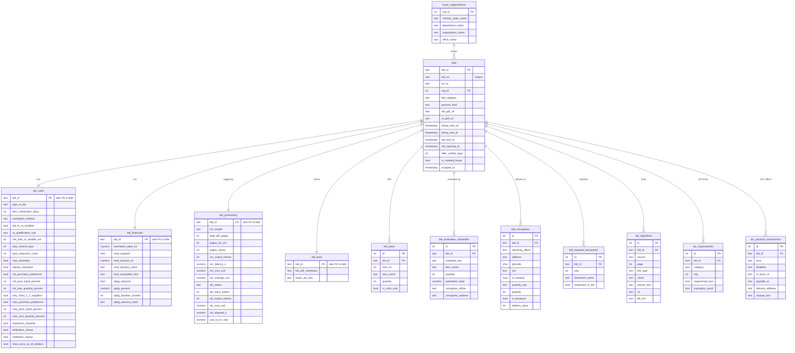

# GeM Bids Database Schema

Relational schema for storing the per-bid JSON files that the scraper writes to `downloads/<bid_id>/<bid_id>.json`.

The design is based on reading all 61 bid JSON files present in `downloads/` (October 2026). Every field in those files was checked. The row counts and data-quality notes below come from that sample.

---

## 1. Overview

- **13 tables.** `bids` is the centre. Every other table links to it through `bid_id`, except `buyer_organisations`, which many bids share.
- **4 tables are 1:1 with `bids`:** `bid_rules`, `bid_financials`, `bid_processing`, `bid_texts`. They split one bid's single-value fields into logical groups.
- **7 tables are 1:many:** items, evaluation schedules, consignees, required documents, hyperlinks, ATC requirements, ATC physical submissions.
- Types are written for PostgreSQL. For SQLite, use `INTEGER PRIMARY KEY` instead of `SERIAL` and `TEXT` for timestamps (ISO 8601 with `+05:30`).

| # | Table | Relation to `bids` | Rows (61 bids) | Holds |
|---|---|---|---|---|
| 1 | `buyer_organisations` | many bids → 1 | shared lookup | Ministry / department / organisation / office |
| 2 | `bids` | centre | 61 | Identity, both date windows, buyer, category |
| 3 | `bid_rules` | 1 : 1 | 61 | Packet type, RA, auto-extension, MII/MSE, relaxations, clauses |
| 4 | `bid_financials` | 1 : 1 | 61 | Estimated value, EMD, ePBG |
| 5 | `bid_items` | 1 : many | 413 | Items from the card / PDF |
| 6 | `bid_evaluation_schedules` | 1 : many | 41 | Item-wise and group-wise schedules |
| 7 | `bid_consignees` | 1 : many | 139 | Delivery points |
| 8 | `bid_required_documents` | 1 : many | 311 | "Document required from seller" list |
| 9 | `bid_hyperlinks` | 1 : many | 451 | Links found in the bid and RA PDFs |
| 10 | `atc_requirements` | 1 : many | ≈ 2,633 | ATC checklist lines (7 text categories) |
| 11 | `atc_physical_submissions` | 1 : many | 76 | Offline EMD / DD / samples / documents |
| 12 | `bid_processing` | 1 : 1 | 61 | OCR and ATC run cost, tokens, status |
| 13 | `bid_texts` | 1 : 1 | 61 | Full PDF markdown and raw ATC text |

---

## 2. ER diagram

Renders on GitHub and in VS Code with a Mermaid extension. To use it in draw.io: **Arrange → Insert → Advanced → Mermaid**.



---

## 3. Table definitions (DDL)

```sql
-- 1. Buyer organisations (shared lookup)
CREATE TABLE buyer_organisations (
  org_id              SERIAL PRIMARY KEY,
  ministry_state_name TEXT,
  department_name     TEXT,     -- "Na" -> NULL
  organisation_name   TEXT,     -- "N/a" -> NULL
  office_name         TEXT,     -- "***" -> NULL
  UNIQUE (ministry_state_name, department_name, organisation_name, office_name)
);

-- 2. Bids (one row per bid)
CREATE TABLE bids (
  bid_id              TEXT PRIMARY KEY,         -- GEM_2026_B_7548490
  bid_no              TEXT UNIQUE NOT NULL,     -- GEM/2026/B/7548490
  ra_no               TEXT,                     -- NULL when the bid has no RA
  org_id              INTEGER REFERENCES buyer_organisations(org_id),
  bid_category        TEXT,   -- one of the 9 listing categories
  process_kind        TEXT,   -- CATALOGUE | BOQ | CUSTOM
  bid_pdf_url         TEXT,
  ra_pdf_url          TEXT,
  listing_start_at    TIMESTAMPTZ,  -- card start; RA window when an RA exists
  listing_end_at      TIMESTAMPTZ,  -- card end;   RA window when an RA exists
  bid_end_at          TIMESTAMPTZ,  -- from the PDF (original bid window)
  bid_opening_at      TIMESTAMPTZ,
  offer_validity_days INTEGER,
  is_masked_buyer     BOOLEAN,      -- defence bids with "***" values
  scraped_at          TIMESTAMPTZ
);

-- 3. Bid rules (1:1)
CREATE TABLE bid_rules (
  bid_id                   TEXT PRIMARY KEY REFERENCES bids(bid_id) ON DELETE CASCADE,
  type_of_bid              TEXT,     -- Two Packet Bid | Single Packet Bid | NULL
  tech_clarification_days  INTEGER,
  evaluation_method        TEXT,     -- Total value wise | Item wise | Item wise consignee wise | Group wise
  bid_to_ra_enabled        BOOLEAN,
  ra_qualification_rule    TEXT,     -- H1-Highest Priced Bid Elimination | 50% Lowest Priced Technically Qualified Bidders
  min_bids_to_disable_ext  INTEGER,
  auto_extend_days         INTEGER,
  auto_extension_count     INTEGER,
  mse_relaxation           BOOLEAN,
  startup_relaxation       BOOLEAN,
  mii_purchase_preference  BOOLEAN,  -- NULL when the PDF does not state it
  mii_price_band_percent   INTEGER,
  mii_max_quantity_percent INTEGER,
  only_class_1_2_suppliers BOOLEAN,
  mse_purchase_preference  BOOLEAN,
  mse_price_band_percent   INTEGER,
  mse_max_quantity_percent INTEGER,
  inspection_required      BOOLEAN,
  arbitration_clause       BOOLEAN,
  mediation_clause         BOOLEAN,
  show_docs_to_all_bidders BOOLEAN
);

-- 4. Bid financials (1:1)
CREATE TABLE bid_financials (
  bid_id               TEXT PRIMARY KEY REFERENCES bids(bid_id) ON DELETE CASCADE,
  estimated_value_inr  NUMERIC(15,2) CHECK (estimated_value_inr IS NULL OR estimated_value_inr < 1e12),
  emd_required         BOOLEAN,
  emd_amount_inr       NUMERIC(15,2) CHECK (emd_amount_inr IS NULL OR emd_amount_inr < 1e11),
  emd_advisory_bank    TEXT,
  emd_exemption_text   TEXT,
  epbg_required        BOOLEAN,
  epbg_percent         NUMERIC(5,2),
  epbg_duration_months INTEGER,
  epbg_advisory_bank   TEXT
);

-- 5. Items (1:many)
CREATE TABLE bid_items (
  id           SERIAL PRIMARY KEY,
  bid_id       TEXT NOT NULL REFERENCES bids(bid_id) ON DELETE CASCADE,
  item_no      INTEGER,
  item_name    TEXT,
  quantity     INTEGER,   -- NULL when unknown
  is_code_only BOOLEAN    -- names like "1300037594" or "09-01-007-E"
);

-- 6. Evaluation schedules (1:many; only item-wise / group-wise bids)
CREATE TABLE bid_evaluation_schedules (
  id                SERIAL PRIMARY KEY,
  bid_id            TEXT NOT NULL REFERENCES bids(bid_id) ON DELETE CASCADE,
  schedule_key      TEXT,       -- "1", "2" ... or a group name such as "FASTENERS"
  item_name         TEXT,
  quantity          INTEGER,
  estimated_value   NUMERIC(15,2),
  consignee_officer TEXT,       -- group-wise only
  consignee_address TEXT        -- group-wise only
);

-- 7. Consignees (1:many)
CREATE TABLE bid_consignees (
  id                SERIAL PRIMARY KEY,
  bid_id            TEXT NOT NULL REFERENCES bids(bid_id) ON DELETE CASCADE,
  reporting_officer TEXT,       -- NULL when "***"
  address           TEXT,
  pincode           CHAR(6),    -- leading 6 digits of the address
  city              TEXT,       -- from masked rows such as "***Jammu"
  is_masked         BOOLEAN,
  quantity_raw      TEXT,       -- keeps values like "Project / Lumpsum Based"
  quantity          INTEGER,    -- NULL when quantity_raw is not a number
  is_lumpsum        BOOLEAN,
  delivery_days     INTEGER
);

-- 8. Required documents (1:many)
CREATE TABLE bid_required_documents (
  id               SERIAL PRIMARY KEY,
  bid_id           TEXT NOT NULL REFERENCES bids(bid_id) ON DELETE CASCADE,
  seq              INTEGER,
  document_name    TEXT,        -- "*In case any bidder..." note removed
  requested_in_atc BOOLEAN      -- name contained "(Requested in ATC)"
);

-- 9. Hyperlinks (1:many)
CREATE TABLE bid_hyperlinks (
  id          SERIAL PRIMARY KEY,
  bid_id      TEXT NOT NULL REFERENCES bids(bid_id) ON DELETE CASCADE,
  source      TEXT,     -- bid | ra
  page        INTEGER,
  link_type   TEXT,     -- see section 5.6
  name        TEXT,
  anchor_text TEXT,
  url         TEXT,
  file_ext    TEXT      -- pdf | docx | xlsx | csv | NULL
);

-- 10. ATC requirements (1:many)
CREATE TABLE atc_requirements (
  id               SERIAL PRIMARY KEY,
  bid_id           TEXT NOT NULL REFERENCES bids(bid_id) ON DELETE CASCADE,
  category         TEXT NOT NULL CHECK (category IN (
                     'STANDARD_DOCS',
                     'ATC_DOCUMENTS_AND_UPLOADS',
                     'EXEMPTIONS_AND_RELAXATIONS',
                     'ELIGIBILITY_AND_QUALIFICATION',
                     'SCOPE_DELIVERY_WARRANTY_AND_SUPPORT',
                     'PRICING_TAX_AND_PAYMENT',
                     'PENALTIES_REJECTION_AND_LEGAL_TERMS')),
  seq              INTEGER,
  requirement_text TEXT,
  exemption_proof  TEXT     -- the "| Proof: ..." part of exemption lines
);

-- 11. ATC physical submissions (1:many)
CREATE TABLE atc_physical_submissions (
  id               SERIAL PRIMARY KEY,
  bid_id           TEXT NOT NULL REFERENCES bids(bid_id) ON DELETE CASCADE,
  item             TEXT,
  deadline         TEXT,    -- "Not specified in source text." -> NULL
  in_favor_of      TEXT,
  payable_at       TEXT,
  delivery_address TEXT,
  original_text    TEXT
);

-- 12. Processing (1:1)
CREATE TABLE bid_processing (
  bid_id            TEXT PRIMARY KEY REFERENCES bids(bid_id) ON DELETE CASCADE,
  ocr_model         TEXT,
  total_pdf_pages   INTEGER,
  pages_for_ocr     INTEGER,
  pages_saved       INTEGER,
  ocr_output_tokens INTEGER,
  ocr_latency_s     NUMERIC(8,3),
  ocr_cost_usd      NUMERIC(10,6),
  ocr_savings_usd   NUMERIC(10,6),
  atc_status        TEXT,   -- success | skipped_no_atc
  atc_input_tokens  INTEGER,
  atc_output_tokens INTEGER,
  atc_cost_usd      NUMERIC(10,6),
  atc_elapsed_s     NUMERIC(8,2),
  usd_to_inr_rate   NUMERIC(8,2)
);

-- 13. Large text (1:1)
CREATE TABLE bid_texts (
  bid_id            TEXT PRIMARY KEY REFERENCES bids(bid_id) ON DELETE CASCADE,
  full_pdf_markdown TEXT,   -- identical to downloads/<bid_id>/<bid_id>.md
  buyer_atc_text    TEXT    -- raw text; contains duplicated sections
);

-- Suggested indexes
CREATE INDEX idx_bids_org          ON bids (org_id);
CREATE INDEX idx_bids_listing_end  ON bids (listing_end_at);
CREATE INDEX idx_bids_category     ON bids (bid_category);
CREATE INDEX idx_items_bid         ON bid_items (bid_id);
CREATE INDEX idx_sched_bid         ON bid_evaluation_schedules (bid_id);
CREATE INDEX idx_consignees_bid    ON bid_consignees (bid_id);
CREATE INDEX idx_consignees_pin    ON bid_consignees (pincode);
CREATE INDEX idx_reqdocs_bid       ON bid_required_documents (bid_id);
CREATE INDEX idx_links_bid_type    ON bid_hyperlinks (bid_id, link_type);
CREATE INDEX idx_atc_req_bid_cat   ON atc_requirements (bid_id, category);
CREATE INDEX idx_atc_phys_bid      ON atc_physical_submissions (bid_id);
```

---

## 4. JSON → column mapping

| JSON path | Table.column | Transform |
|---|---|---|
| `_id` | `bids.bid_id` | as is |
| `bid.bid_no` | `bids.bid_no` | as is |
| `bid.ra_no` | `bids.ra_no` | `""` → NULL |
| `bid.bid_type` | `bids.bid_category` | as is |
| `bid.process_kind` | `bids.process_kind` | as is |
| `card.bid_pdf_url` / `card.ra_pdf_url` | `bids.bid_pdf_url` / `ra_pdf_url` | `""` → NULL |
| `card.start_datetime` / `card.end_datetime` | `bids.listing_start_at` / `listing_end_at` | `DD-MM-YYYY HH:MM:SS` → timestamp, IST (+05:30) |
| `pdf.timing.bid_end_datetime` / `bid_opening_datetime` | `bids.bid_end_at` / `bid_opening_at` | same as above |
| `pdf.timing.bid_offer_validity_days` | `bids.offer_validity_days` | as is |
| `pdf.departments.*` | `buyer_organisations.*` → `bids.org_id` | placeholders → NULL, then look up or insert |
| `pdf.bid_type.*`, `pdf.ra.*`, `pdf.auto_extension.*`, `pdf.relaxations.*`, `pdf.mii.*`, `pdf.mse.*`, `pdf.inspection.inspection_required`, `pdf.clauses.*`, `pdf.evaluation.evaluation_method`, `pdf.documents.show_uploaded_docs_to_all_bidders` | `bid_rules.*` | `"Yes"`/`"No"` → boolean; `""` → NULL |
| `pdf.financials.*` | `bid_financials.*` | out-of-range amounts → NULL |
| `pdf.items["item N"]` | `bid_items` | `item_no` = N |
| `pdf.evaluation.schedules` | `bid_evaluation_schedules` | flat (item-wise) or nested (group-wise) |
| `pdf.consignees[]` | `bid_consignees` | split pincode / city / quantity |
| `pdf.documents.required_from_seller[]` | `bid_required_documents` | strip trailing note |
| `hyperlinks[]` | `bid_hyperlinks` | add `link_type`, `file_ext` |
| `atc_analysis.checklist.<CATEGORY>[]` (7 text lists) | `atc_requirements` | one row per line |
| `atc_analysis.checklist.PHYSICAL_SUBMISSIONS[]` | `atc_physical_submissions` | placeholder text → NULL |
| `atc_analysis.status`, `.tokens`, `.cost_usd`, `.elapsed_seconds` | `bid_processing.atc_*` | as is |
| `telemetry.ocr.*` | `bid_processing.ocr_*`, `total_pdf_pages`, `pages_*` | as is |
| `full_pdf_text` | `bid_texts.full_pdf_markdown` | as is |
| `pdf.terms.buyer_atc.generic` | `bid_texts.buyer_atc_text` | as is |

---

## 5. Loading rules (data cleaning)

These rules come from the values actually seen in the 61 files. The loader should apply them.

### 5.1 Dates
- The card dates and the PDF dates are different windows. When a bid has an RA number, the card shows the reverse-auction window. For example, GEM_2025_B_6726924 has card dates 13→14 Oct 2026, while the PDF bid ended on 17 Nov 2025. Store both.
- Card dates can also be later than the PDF dates because of a corrigendum extension (e.g. GEM_2026_B_7945906). The card is the current value.
- Store all dates as IST (`+05:30`).

### 5.2 Buyer organisations
- Convert placeholders to NULL: `office_name = "***"` (18 bids), `department_name = "Na"` (2), `organisation_name = "N/a"` (6).
- Set `bids.is_masked_buyer = true` when the office or the consignee officer is `***` (defence buyers).
- Buyers repeat. In the sample, GSECL appears 4 times, Andhra Pradesh Health (APMSIDC) 4 times, and ITBP and AIIMS Raipur 3 times each.

### 5.3 Items and schedules
- `card.items`, `pdf.items` and `normalized.items.items_breakdown` are identical in all 61 files. Load items once, from `pdf.items`.
- Item names are often split wrongly on commas. Examples:
  - GEM_2026_B_7799733: "SINGLE PHASE", "0.75 HP", "CONFIRMED TO"
  - GEM_2026_B_8016367: "150#"
  - GEM_2026_B_8058667: "Make : Elent"
- When an item-wise evaluation schedule exists, its names and quantities are the correct ones. For example, GEM_2026_B_7983533 has 4 fragment items but 2 correct schedule items. Prefer the schedule in reports.
- Set `is_code_only = true` for names that are only codes, such as `1300037594` or `09-01-007-E`.
- Item quantity is unknown for 330 of 413 items. Store NULL, not 0.
- The group-wise schedule parser is incomplete. GEM_2026_B_8019323 has 133 items, but only 6 schedule rows were captured.

### 5.4 Consignees
- The address starts with a 6-digit pincode in 69 of 139 rows (e.g. `365601,GMSCL-Ware House_Amreli`). Extract it into `pincode`.
- 70 rows are masked as `***City` (e.g. `***Jammu`). Set `is_masked = true` and put the city in `city`.
- Quantity is not always a number:
  - `"Project / Lumpsum Based"` appears 9 times. Set `is_lumpsum = true`.
  - One row has a person's name, "Mantu Kumar" (GEM_2026_B_8016367). Keep it in `quantity_raw` and set `quantity` to NULL.
- `delivery_days` is empty in 14 rows. Store NULL.

### 5.5 Required documents
- The last entry usually ends with the note `*In case any bidder is seeking exemption from Experience / Turnover Criteria…`. Cut everything from `*` onwards.
- Set `requested_in_atc = true` for names containing `(Requested in ATC)`, e.g. "Certificate", "Additional Doc 1".

### 5.6 Hyperlinks — `link_type` values

| link_type | Rule | Count |
|---|---|---|
| `ra_boilerplate` | source `ra` and (TCPDF credit, link back to bid PDF, or GTC) | 84 |
| `gtc` | `gtc/pdfByDate` or `general-terms-and-conditions` | 71 |
| `specification` | `SpecificationDocument` or `BoqDocument` | 69 |
| `bid_attachment` | `/biddoc/` | 50 |
| `atc_document` | name "Buyer uploaded ATC document" | 45 |
| `om_ppd` | `downloadOmppdfile` | 40 |
| `buyer_doc` | `downloadMseMiiDoc` or `documentdownload` | 24 |
| `buyer_excel` | `downloadExcelFile` or `/excel/` | 18 |
| `sla` | `bidsla` | 12 |
| `boq_detail` | `BoqLineItemsDocument` (CSV) | 12 |
| `catalogue_spec` | `showCatalogue` | 8 |
| `email` | `mailto:` | 4 |
| `integrity_pact` | name contains "integrity pact" | 3 |
| `file_attachment` | `CLM0012` (scope-of-work file) | 2 |
| `other` | anything else | 9 |

`ra_boilerplate` rows can be skipped at load time; they appear in every RA PDF and carry no information. Hyperlink names often contain broken Hindi text from the PDF; `link_type` is the reliable field.

### 5.7 Financials
- One bid has an impossible EMD of 310,900,032,238,503,155,928,169 ₹ (GEM_2026_B_8103567), where digits were glued together. The `CHECK` constraints reject such values, so the loader should set them to NULL and log them.
- `emd_required` is true for 44 bids, but the amount is missing for many of them. That is a real gap in the PDF, not a loader error.
- `emd_exemption_text` sometimes contains unrelated ATC text (e.g. GEM_2026_B_8074855).

### 5.8 ATC checklist
- In 3 bids (GEM_2026_B_7548490, GEM_2026_B_8062401, GEM_2026_B_8111835) `checklist` is a list containing one object instead of an object. Use the first element.
- 2 bids have `status = "skipped_no_atc"` and an empty checklist. They get a `bid_processing` row and no ATC rows.
- In physical submissions, convert `"Not specified in source text."` (and variants) to NULL.
- The same physical submission is sometimes listed twice (e.g. GEM_2026_B_7625121). Keep both; they come from different clauses.
- For `EXEMPTIONS_AND_RELAXATIONS`, split lines of the form `Exemption: … | Proof: …` into `requirement_text` and `exemption_proof`.

### 5.9 Text fields
- `full_pdf_text` is identical to `<bid_id>.md` in all 61 files.
- `pdf.terms.buyer_atc.generic` contains the ATC section twice (OCR copy and PyMuPDF copy).
- `pdf.terms.disclaimer` is the same GeM boilerplate in every bid, and in some bids it contains the ATC text instead (e.g. GEM_2026_B_7986837, GEM_2026_B_8049245). It is not stored.

---

## 6. Fields not stored

| JSON field | Reason |
|---|---|
| `card.items`, `normalized.items.items_breakdown` | identical to `pdf.items` in all 61 files |
| `card.departments` | identical to `pdf.departments` in all 61 files |
| `normalized.financials`, `normalized.dates` | derived from fields already stored |
| `normalized.dates.days_remaining`, `is_expired` | change every minute; compute at query time |
| `normalized.preferences.mii_preference`, `mse_preference` | always `false` because of a normalizer bug; use `bid_rules.mii_purchase_preference` / `mse_purchase_preference` |
| `bid.product_type`, `bid.base_type` | for 34 bids they repeat the listing category; `process_kind` keeps the useful part |
| `pdf.documents.attachments`, `pdf.financials.emd.schedule_breakup`, `pdf.inspection.inspection_agency_type`, `pdf.terms.buyer_atc.items` / `hard_requirements` / `info_clauses`, `pdf.terms.special_terms_text` / `special_terms_version`, `telemetry.ocr.input_tokens` | empty in all 61 files |
| `pdf.terms.disclaimer` | identical boilerplate; sometimes wrong text |
| `validation.*` | warnings recomputed by the code on every run |
| `atc_analysis.bid_no`, `atc_analysis.error` | duplicate of `bid_id` / always null |

---

## 7. Example queries

```sql
-- Open bids closing in the next 3 days, with buyer and EMD
SELECT b.bid_no, o.organisation_name, b.listing_end_at, f.emd_amount_inr
FROM bids b
JOIN buyer_organisations o ON o.org_id = b.org_id
LEFT JOIN bid_financials f ON f.bid_id = b.bid_id
WHERE b.listing_end_at BETWEEN now() AND now() + interval '3 days'
ORDER BY b.listing_end_at;

-- Bids with MSE relaxation and no EMD requirement
SELECT b.bid_no, b.bid_category
FROM bids b
JOIN bid_rules r USING (bid_id)
JOIN bid_financials f USING (bid_id)
WHERE r.mse_relaxation AND NOT f.emd_required;

-- Physical submissions needed for one bid
SELECT item, deadline, in_favor_of, payable_at, delivery_address
FROM atc_physical_submissions
WHERE bid_id = 'GEM_2025_B_6726924';

-- Download link for every buyer-uploaded ATC document
SELECT bid_id, url, file_ext
FROM bid_hyperlinks
WHERE link_type = 'atc_document';

-- Total OCR + ATC spend in INR
SELECT SUM((ocr_cost_usd + COALESCE(atc_cost_usd, 0)) * usd_to_inr_rate) AS total_inr
FROM bid_processing;
```

---

## 8. Relation to the current `storage/gem_bids.db`

The existing SQLite database (`storage/database.py`) has one flat `bids` table keyed on `document_url`, plus `run_log`. This schema replaces the flat table. `run_log` can stay as it is. `document_url` maps to `bids.bid_pdf_url`, and `bid_id` becomes the primary key because it is stable across corrigenda and RA phases.
