# GeM Bids Relational Database Schema Architecture (v2.0)

**Document Reference:** `DATABASE_SCHEMA_2.md`  
**Target Storage Engine:** PostgreSQL / MySQL 8.0+ / SQLite 3  
**Corpus Source:** 61 Extracted Tender Directories in `F:\Projects\gem_scraper\downloads`  
**Dataset Size:** 4.63 MB (413 items, 139 consignees, 451 hyperlinks, 2,633 compliance rules, 76 physical submissions)  

---

## 1. Executive Summary & Design Rationale

This document establishes the production-grade relational database schema for storing, indexing, and querying government tenders scraped and parsed by the **GeM Scraper & ATC Compliance Engine**.

### Why 10 Tables?
In the earlier baseline schema (`storage/database.py`), bids were stored in a single flat table with 18 columns, dumping all items, schedules, hyperlinks, and compliance clauses into unstructured string text. That flat structure prevents relational querying (e.g., querying bids by delivery destination, finding bids requiring physical samples, or filtering by individual item quantities).

The **v2.0 architecture** establishes a **10-table normalized relational model (3NF)**:
1. **Core Tender Entity (`bids`)**: Consolidates all scalar attributes (identity, procuring entity, dates, financial limits, and policy preferences) into a single master table. This avoids unnecessary 1:1 joins for common queries.
2. **Dynamic 1-to-Many Entities**: Separate child tables for `bid_items`, `bid_consignees`, `bid_evaluation_schedules`, `bid_required_documents`, `bid_hyperlinks`, `bid_atc_checklist_items`, and `bid_atc_physical_submissions`.
3. **Storage Decoupling (`bid_terms` & `bid_atc_analyses`)**: Heavy text blocks (raw parsed PDF Markdown, Generic Buyer ATC clauses, and AI token/cost telemetry) are isolated into dedicated 1:1 tables. This guarantees that `SELECT * FROM bids` remains fast, scanning lightweight rows without loading megabytes of text.

---

## 2. Empirical Dataset Audit (61 Bids Analyzed)

Every directory and `<bid_id>.json` file in `F:\Projects\gem_scraper\downloads` was scanned and audited to determine exact data ranges, nullability, and structural variations.

### Key Metrics Across the 61-File Corpus
* **Total Tenders Audited:** 61 directories (100% verified)
* **Total Line Items:** 413 items (ranging from 1 to **133 items** in a single tender, e.g., `GEM_2026_B_8019323`)
* **Tenders with Multiple Items:** 34 bids (55.7%)
* **Total Delivery Consignees:** 139 locations (ranging from 0 to **30 consignees** in a single tender)
* **Tenders with 0 Consignees:** 16 bids (Rate contracts & global tenders without fixed delivery points)
* **Total Hyperlinks Extracted:** 451 links (3 to 16 links per bid across catalogues, GTCs, and ATC PDFs)
* **Total ATC Compliance Clauses:** 2,633 extracted clauses across 7 compliance domains
* **Offline Physical Submissions:** 76 instruments (EMD Demand Drafts, Physical Samples, Performance Guarantees)
* **EMD Required:** 44 bids (72.1%) | EMD Exempted/Not Required: 17 bids (27.9%)
* **ePBG Required:** 44 bids (72.1%) | ePBG Exempted/Not Required: 17 bids (27.9%)

### Bid Type Distribution
* `Product Bid/RAs`: 8 bids
* `Limited Tender`: 8 bids
* `Single Tender`: 8 bids
* `Service Bid/RAs`: 7 bids
* `Product Custom Bid/RAs`: 7 bids
* `Bid To RAs`: 7 bids
* `BOQ Bids`: 6 bids
* `Global Tender`: 5 bids
* `Rate Contract Bids`: 5 bids

### Evaluation Methodology Distribution
1. `Total value wise evaluation`: 47 bids (schedules dictionary is `{}`)
2. `Item wise evaluation`: 8 bids (e.g. `GEM_2026_B_8072933` has 15 distinct schedules)
3. `Item wise consignee wise evaluation`: 5 bids (Rate contracts with empty schedule objects)
4. `Group wise evaluation`: 1 bid (`GEM_2026_B_8019323`: contains named groups like `"FASTENERS"` with sub-items `"Item_1"` to `"Item_6"`)

---

## 3. Critical Schema Edge Cases & Ingestion Rules

Field-by-field verification revealed specific edge cases that dictate database constraints:

1. **Unestimated Tenders (Nullable `estimated_value`):**
   * **34 out of 61 tenders (55.7%)** have `estimated_value = null` (undisclosed by buyers for commercial or confidentiality reasons).
   * **Schema Requirement:** `estimated_value` must be `NUMERIC(15,2) NULL`.
2. **Rate Contract Quantities (Nullable `quantity`):**
   * In Rate Contracts and generic BOQ entries, individual item quantities are not declared in the summary card or table. Across all 61 files, **330 item records have `quantity = null`**.
   * **Schema Requirement:** `quantity` in `bid_items` must be `NUMERIC(12,2) NULL`.
3. **Consignee Quantity & Lead Times as Numeric Strings:**
   * In `pdf.consignees`, numbers are extracted as strings (e.g. `"quantity": "255"`, `"delivery_days": "330"`).
   * **Schema Requirement:** Cast strings to `NUMERIC(12,2)` and `INTEGER` during DB ingestion.
4. **ATC Analysis Checklist Inconsistency:**
   * In 56 bids, `atc_analysis.checklist` is a JSON Object `{ "STANDARD_DOCS": [...] }`.
   * In 3 bids (`GEM_2026_B_7548490`, `GEM_2026_B_8062401`, `GEM_2026_B_8111835`), LLM output was wrapped in a 1-element Array `[ { "STANDARD_DOCS": [...] } ]`.
   * In 2 bids (`GEM_2026_B_8076869`, `GEM_2026_B_8078595`), ATC analysis was skipped (`has_atc: false`, `status: "skipped_no_atc"`).
   * **Schema Requirement:** Ingestion code must unwrap arrays before populating `bid_atc_checklist_items`.

---

## 4. Entity-Relationship (ER) Diagram

```mermaid
erDiagram
    bids ||--o{ bid_items : "1:N (Items requested)"
    bids ||--o{ bid_consignees : "1:N (Delivery locations)"
    bids ||--o{ bid_evaluation_schedules : "1:N (Item/Group schedules)"
    bids ||--o{ bid_required_documents : "1:N (Mandatory docs)"
    bids ||--o{ bid_hyperlinks : "1:N (Referenced URLs)"
    bids ||--|| bid_terms : "1:1 (Heavy text & raw PDF)"
    bids ||--o| bid_atc_analyses : "1:1 (AI audit telemetry)"
    bids ||--o{ bid_atc_checklist_items : "1:N (Categorized clauses)"
    bids ||--o{ bid_atc_physical_submissions : "1:N (Offline instruments)"

    bids {
        varchar id PK "e.g. GEM_2025_B_6726924"
        varchar bid_no UK "e.g. GEM/2025/B/6726924"
        varchar ra_no "Reverse Auction No (Nullable)"
        varchar bid_type "Product Bid, BOQ, Service, etc."
        varchar product_type "Product or Service"
        varchar base_type "PRODUCT, BOQ, CUSTOM"
        varchar process_kind "CATALOGUE, BOQ, CUSTOM"
        varchar bid_packet_type "Two Packet, Single Packet"
        varchar ministry_state_name "Ministry or State"
        varchar department_name "Department Name"
        varchar organisation_name "Procuring Organisation"
        varchar office_name "Procuring Office Branch"
        timestamp start_datetime "Publish Date"
        timestamp end_datetime "Bid Closing Deadline"
        timestamp bid_opening_datetime "Opening Date"
        int bid_offer_validity_days "Validity (Days)"
        numeric bid_duration_days "Duration in Days"
        numeric days_remaining "Remaining Time"
        boolean is_expired "Expired Flag"
        numeric estimated_value "Estimated Cost (Nullable)"
        boolean is_high_value "High Value Tender Flag"
        boolean emd_required "EMD Required Flag"
        numeric emd_amount "EMD Amount INR (Nullable)"
        varchar emd_advisory_bank "EMD Bank"
        boolean epbg_required "ePBG Required Flag"
        numeric epbg_percent "ePBG Percentage (Nullable)"
        varchar epbg_advisory_bank "ePBG Bank"
        int epbg_duration_months "ePBG Duration (Months)"
        varchar evaluation_method "Total/Item/Group Wise"
        boolean bid_to_ra_enabled "RA Enabled Flag"
        varchar ra_qualification_rule "RA Rule (H1 Elimination)"
        int clarification_window_days "Clarification Window (Days)"
        boolean inspection_required "Inspection Required Flag"
        boolean arbitration_clause "Arbitration Clause Flag"
        boolean mediation_clause "Mediation Clause Flag"
        boolean mse_preference "MSE Purchase Preference"
        numeric mse_price_band_percent "MSE Margin (e.g. 10.00)"
        numeric mse_max_quantity_percent "MSE Split (e.g. 70.00)"
        boolean mse_relaxation "MSE Turnover Relaxation"
        boolean startup_relaxation "Startup Turnover Relaxation"
        boolean mii_preference "Make In India Preference"
        numeric mii_price_band_percent "MII Price Band"
        numeric mii_max_quantity_percent "MII Max Quantity"
        boolean auto_extension_enabled "Auto Extension Flag"
        int min_bids_disable_extension "Min Bids to Disable Extension"
        int auto_extend_days "Days per Extension"
        int auto_extension_count "Max Extension Cycles"
        text bid_pdf_url "Portal PDF URL"
        text ra_pdf_url "Portal RA PDF URL"
        timestamp created_at "Record Creation Timestamp"
    }

    bid_items {
        bigint id PK
        varchar bid_id FK "References bids.id"
        int item_index "Item Position (1, 2, ...)"
        varchar item_category "Item Description / Name"
        numeric quantity "Quantity (Nullable for Rate Contracts)"
        varchar source "Source: card or pdf"
    }

    bid_consignees {
        bigint id PK
        varchar bid_id FK "References bids.id"
        varchar officer_name "Consignee Reporting Officer"
        text address "Delivery Destination / Depot"
        numeric quantity "Allocated Delivery Quantity"
        int delivery_days "Delivery Turnaround Days"
    }

    bid_evaluation_schedules {
        bigint id PK
        varchar bid_id FK "References bids.id"
        varchar schedule_name "Schedule No (1..15) or Group Name"
        varchar sub_item_key "Sub-item (e.g. Item_1, Item_2)"
        varchar item_category "Scheduled Item Description"
        numeric quantity "Scheduled Quantity"
        numeric estimated_value "Schedule Estimated Value"
        varchar consignee_officer "Schedule Officer"
        text consignee_address "Schedule Location"
    }

    bid_required_documents {
        bigint id PK
        varchar bid_id FK "References bids.id"
        varchar document_name "Prerequisite Document Name"
    }

    bid_hyperlinks {
        bigint id PK
        varchar bid_id FK "References bids.id"
        int page_number "PDF Page Number"
        varchar link_name "Label or Anchor Name"
        text url "Target URL"
        varchar source "Source: bid or ra"
    }

    bid_terms {
        varchar bid_id PK "1:1 Foreign Key to bids.id"
        varchar special_terms_version "Version String"
        text special_terms_text "Special Terms Content"
        text buyer_atc_text "Full Generic ATC Text"
        text emd_exemption_text "EMD Exemption Rules"
        text disclaimer "GeM Legal Disclaimer"
        text full_pdf_text "Complete Extracted PDF Markdown"
    }

    bid_atc_analyses {
        varchar bid_id PK "1:1 Foreign Key to bids.id"
        varchar status "success, skipped_no_atc, error"
        boolean has_atc "ATC Detected Flag"
        numeric elapsed_seconds "LLM Runtime Latency"
        numeric cost_usd "LLM Cost USD"
        numeric cost_inr "LLM Cost INR"
        int input_tokens "Prompt Tokens"
        int output_tokens "Completion Tokens"
        text error_message "Error Log (if any)"
    }

    bid_atc_checklist_items {
        bigint id PK
        varchar bid_id FK "References bids.id"
        varchar category "STANDARD_DOCS, PRICING, SCOPE, etc."
        text clause_text "Extracted Compliance Requirement"
        int display_order "Sequence Index in Category"
    }

    bid_atc_physical_submissions {
        bigint id PK
        varchar bid_id FK "References bids.id"
        varchar item_name "Instrument (EMD DD, Samples, PBG)"
        varchar deadline "Submission Time Window"
        varchar in_favor_of "Beneficiary / Payee Name"
        varchar payable_at "Payable City / Branch"
        text delivery_address "Physical Drop-off / Postal Address"
        text original_clause_text "Exact Extracted Document Excerpt"
    }
```



---

## 5. Comprehensive Data Dictionary (10 Tables)

### Table 1: `bids` (Master Tender Table)
Primary key table storing normalized scalar tender information.

| Column Name | SQL Type | Nullable? | JSON Path Source | Description |
| :--- | :--- | :---: | :--- | :--- |
| `id` | `VARCHAR(64)` | **NO (PK)** | `_id` | Alphanumeric unique tender ID (e.g. `GEM_2025_B_6726924`) |
| `bid_no` | `VARCHAR(64)` | **NO (UK)** | `bid.bid_no` | Official portal bid number (e.g. `GEM/2025/B/6726924`) |
| `ra_no` | `VARCHAR(64)` | YES | `bid.ra_no` | Reverse auction number (NULL in 25 bids) |
| `bid_type` | `VARCHAR(64)` | NO | `bid.bid_type` | Bid category (e.g., `Product Bid/RAs`, `BOQ Bids`) |
| `product_type` | `VARCHAR(64)` | NO | `bid.product_type` | `Product` or `Service` |
| `base_type` | `VARCHAR(64)` | NO | `bid.base_type` | `PRODUCT`, `BOQ`, `CUSTOM_PRODUCT` |
| `process_kind` | `VARCHAR(64)` | NO | `bid.process_kind` | `CATALOGUE`, `BOQ`, `CUSTOM` |
| `bid_packet_type` | `VARCHAR(64)` | YES | `pdf.bid_type.type_of_bid` | e.g. `Two Packet Bid`, `Single Packet Bid` |
| `ministry_state_name` | `VARCHAR(255)` | YES | `pdf.departments.ministry_state_name` | Procuring state or central ministry |
| `department_name` | `VARCHAR(255)` | YES | `pdf.departments.department_name` | Procuring department |
| `organisation_name` | `VARCHAR(255)` | YES | `pdf.departments.organisation_name` | Procuring PSU, board, or corporation |
| `office_name` | `VARCHAR(255)` | YES | `pdf.departments.office_name` | Local procuring office |
| `start_datetime` | `TIMESTAMP` | YES | `normalized.dates.start_date_iso` | Official tender publish timestamp |
| `end_datetime` | `TIMESTAMP` | **NO** | `normalized.dates.end_date_iso` | Tender submission deadline |
| `bid_opening_datetime`| `TIMESTAMP` | YES | `pdf.timing.bid_opening_datetime` | Technical bid opening timestamp |
| `bid_offer_validity_days`| `INT` | YES | `pdf.timing.bid_offer_validity_days` | Offer validity window in days (e.g. 180) |
| `bid_duration_days` | `NUMERIC(6,2)` | YES | `normalized.dates.bid_duration_days` | Total listing duration in days |
| `days_remaining` | `NUMERIC(6,2)` | YES | `normalized.dates.days_remaining` | Remaining days before deadline |
| `is_expired` | `BOOLEAN` | NO | `normalized.dates.is_expired` | Whether deadline has elapsed |
| `estimated_value` | `NUMERIC(15,2)` | **YES** | `normalized.financials.estimated_value_inr` | Total estimated procurement value (INR) |
| `is_high_value` | `BOOLEAN` | NO | `normalized.financials.high_value_tender` | Flag for high-value tenders |
| `emd_required` | `BOOLEAN` | NO | `normalized.financials.emd.required` | True if EMD is mandatory |
| `emd_amount` | `NUMERIC(15,2)` | YES | `normalized.financials.emd.amount_inr` | Total EMD in INR (NULL/0 if exempt) |
| `emd_advisory_bank` | `VARCHAR(128)` | YES | `pdf.financials.emd.advisory_bank` | Advisory bank for EMD instruments |
| `epbg_required` | `BOOLEAN` | NO | `normalized.financials.epbg.required` | True if ePBG is mandatory |
| `epbg_percent` | `NUMERIC(5,2)` | YES | `pdf.financials.epbg.percent` | Performance security percentage (e.g. 5.00) |
| `epbg_advisory_bank` | `VARCHAR(128)` | YES | `pdf.financials.epbg.advisory_bank` | Advisory bank for ePBG instruments |
| `epbg_duration_months`| `INT` | YES | `pdf.financials.epbg.duration_months` | PBG validity period in months |
| `evaluation_method` | `VARCHAR(128)` | NO | `pdf.evaluation.evaluation_method` | `Total value wise`, `Item wise`, etc. |
| `bid_to_ra_enabled` | `BOOLEAN` | NO | `pdf.ra.bid_to_ra_enabled` | RA conversion flag |
| `ra_qualification_rule`| `VARCHAR(128)` | YES | `pdf.ra.ra_qualification_rule` | RA elimination rule |
| `clarification_window_days`| `INT` | YES | `pdf.bid_type.technical_clarification_window_days` | Clarification response window (Days) |
| `inspection_required`| `BOOLEAN` | NO | `pdf.inspection.inspection_required` | Inspection mandated |
| `arbitration_clause` | `BOOLEAN` | NO | `pdf.clauses.arbitration_clause` | Arbitration terms active |
| `mediation_clause` | `BOOLEAN` | NO | `pdf.clauses.mediation_clause` | Mediation terms active |
| `mse_preference` | `BOOLEAN` | NO | `pdf.mse.mse_purchase_preference` | MSE purchase preference |
| `mse_price_band_percent`| `NUMERIC(5,2)` | YES | `pdf.mse.mse_price_band_percent` | MSE price band percent (e.g. 10.00) |
| `mse_max_quantity_percent`| `NUMERIC(5,2)` | YES | `pdf.mse.mse_max_quantity_percent` | Max allocated quantity percent (e.g. 70.00) |
| `mse_relaxation` | `BOOLEAN` | NO | `pdf.relaxations.mse_relaxation_experience_turnover` | MSE relaxation active |
| `startup_relaxation`| `BOOLEAN` | NO | `pdf.relaxations.startup_relaxation_experience_turnover` | Startup relaxation active |
| `mii_preference` | `BOOLEAN` | NO | `pdf.mii.mii_purchase_preference` | Make In India purchase preference |
| `mii_price_band_percent`| `NUMERIC(5,2)` | YES | `pdf.mii.mii_price_band_percent` | MII price band margin |
| `mii_max_quantity_percent`| `NUMERIC(5,2)` | YES | `pdf.mii.mii_max_quantity_percent` | MII max allocated split |
| `auto_extension_enabled`| `BOOLEAN` | NO | `pdf.auto_extension.auto_extension_count > 0` | Auto-extension active |
| `min_bids_disable_extension`| `INT` | YES | `pdf.auto_extension.min_bids_to_disable_extension` | Minimum bids threshold |
| `auto_extend_days` | `INT` | YES | `pdf.auto_extension.auto_extend_days` | Number of days extended |
| `auto_extension_count`| `INT` | YES | `pdf.auto_extension.auto_extension_count` | Permitted extension cycles |
| `bid_pdf_url` | `TEXT` | YES | `card.bid_pdf_url` | Direct link to original Bid PDF |
| `ra_pdf_url` | `TEXT` | YES | `card.ra_pdf_url` | Direct link to RA PDF |
| `created_at` | `TIMESTAMP` | NO | System Timestamp | DB record ingestion timestamp |

---

### Table 2: `bid_items` (Tender Item Breakdown)
Stores individual item categories and quantities. Accommodates 1 to 133 items per tender.

| Column Name | SQL Type | Nullable? | JSON Path Source | Description |
| :--- | :--- | :---: | :--- | :--- |
| `id` | `BIGSERIAL` | **NO (PK)** | Surrogate Key | Unique sequence key |
| `bid_id` | `VARCHAR(64)` | **NO (FK)** | `_id` | References `bids(id) ON DELETE CASCADE` |
| `item_index` | `INT` | NO | Item sequence | Item position index (1, 2, 3...) |
| `item_category` | `VARCHAR(500)`| NO | `item_category` / `name` | Extracted product name or category |
| `quantity` | `NUMERIC(12,2)`| **YES** | `quantity` | Quantity (NULL in rate contracts/BOQs) |
| `source` | `VARCHAR(16)` | NO | Internal tag | Extracted origin: `'pdf'` or `'card'` |

---

### Table 3: `bid_consignees` (Delivery Locations & Officers)
Stores consignee delivery locations, designated officers, and delivery windows.

| Column Name | SQL Type | Nullable? | JSON Path Source | Description |
| :--- | :--- | :---: | :--- | :--- |
| `id` | `BIGSERIAL` | **NO (PK)** | Surrogate Key | Unique sequence key |
| `bid_id` | `VARCHAR(64)` | **NO (FK)** | `_id` | References `bids(id) ON DELETE CASCADE` |
| `officer_name` | `VARCHAR(255)`| YES | `consignee_reporting_officer` | Designee or reporting officer name |
| `address` | `TEXT` | NO | `consignee_address` | Destination warehouse/office address |
| `quantity` | `NUMERIC(12,2)`| NO | `quantity` (cast) | Quantity to deliver to this destination |
| `delivery_days` | `INT` | NO | `delivery_days` (cast) | Allowed turnaround delivery days |

---

### Table 4: `bid_evaluation_schedules` (Lot-wise Evaluation Breakdown)
Stores multi-schedule lots when bids are evaluated item-wise or group-wise.

| Column Name | SQL Type | Nullable? | JSON Path Source | Description |
| :--- | :--- | :---: | :--- | :--- |
| `id` | `BIGSERIAL` | **NO (PK)** | Surrogate Key | Unique sequence key |
| `bid_id` | `VARCHAR(64)` | **NO (FK)** | `_id` | References `bids(id) ON DELETE CASCADE` |
| `schedule_name` | `VARCHAR(128)`| NO | `schedules.<key>` | Schedule number (e.g. `'1'`) or Group (`'FASTENERS'`) |
| `sub_item_key` | `VARCHAR(64)` | YES | `Item_1` / subkey | Sub-item code if grouped |
| `item_category` | `VARCHAR(500)`| YES | `Item/Category` | Description of scheduled category |
| `quantity` | `NUMERIC(12,2)`| YES | `Quantity` (cast) | Schedule allocated quantity |
| `estimated_value`| `NUMERIC(15,2)`| YES | `Estimated Value` | Schedule estimated cost |
| `consignee_officer`| `VARCHAR(255)`| YES | `Consignee/Reporting Officer`| Assigned schedule officer |
| `consignee_address`| `TEXT` | YES | `Consignee Address` | Delivery destination for schedule |

---

### Table 5: `bid_required_documents` (Seller Eligibility Documents)
Stores list of certificates and documents required from seller.

| Column Name | SQL Type | Nullable? | JSON Path Source | Description |
| :--- | :--- | :---: | :--- | :--- |
| `id` | `BIGSERIAL` | **NO (PK)** | Surrogate Key | Unique sequence key |
| `bid_id` | `VARCHAR(64)` | **NO (FK)** | `_id` | References `bids(id) ON DELETE CASCADE` |
| `document_name` | `VARCHAR(500)`| NO | `documents.required_from_seller[]` | Document title (e.g., *Past Performance*, *OEM Authorization*) |

---

### Table 6: `bid_hyperlinks` (Embedded URL Catalog)
Stores all hyperlinks embedded in the tender PDFs and card.

| Column Name | SQL Type | Nullable? | JSON Path Source | Description |
| :--- | :--- | :---: | :--- | :--- |
| `id` | `BIGSERIAL` | **NO (PK)** | Surrogate Key | Unique sequence key |
| `bid_id` | `VARCHAR(64)` | **NO (FK)** | `_id` | References `bids(id) ON DELETE CASCADE` |
| `page_number` | `INT` | YES | `hyperlinks[].page` | PDF page number where link is embedded |
| `link_name` | `VARCHAR(255)`| YES | `hyperlinks[].name` | Anchor name or descriptive label |
| `url` | `TEXT` | NO | `hyperlinks[].url` | Destination URL |
| `source` | `VARCHAR(16)` | NO | `hyperlinks[].source` | Origin document (`'bid'` or `'ra'`) |

---

### Table 7: `bid_terms` (Heavy Text & Raw PDF Markdown)
Isolates multi-megabyte text payloads from the core `bids` table.

| Column Name | SQL Type | Nullable? | JSON Path Source | Description |
| :--- | :--- | :---: | :--- | :--- |
| `bid_id` | `VARCHAR(64)` | **NO (PK, FK)**| `_id` | References `bids(id) ON DELETE CASCADE` |
| `special_terms_version`| `VARCHAR(64)`| YES | `pdf.terms.special_terms_version` | Special terms revision |
| `special_terms_text` | `TEXT` | YES | `pdf.terms.special_terms_text` | Special terms clause |
| `buyer_atc_text` | `TEXT / LONGTEXT`| YES | `pdf.terms.buyer_atc.generic` | Full generic buyer-added ATC clauses |
| `emd_exemption_text` | `TEXT` | YES | `pdf.financials.emd_exemption_text`| Detailed EMD exemption rules |
| `disclaimer` | `TEXT` | YES | `pdf.terms.disclaimer` | Portal disclaimer statement |
| `full_pdf_text` | `TEXT / LONGTEXT`| YES | `full_pdf_text` | Complete raw parsed Markdown text |

---

### Table 8: `bid_atc_analyses` (AI Compliance Audit Telemetry)
Stores execution status, latency, and token cost telemetry of the LLM compliance analyzer.

| Column Name | SQL Type | Nullable? | JSON Path Source | Description |
| :--- | :--- | :---: | :--- | :--- |
| `bid_id` | `VARCHAR(64)` | **NO (PK, FK)**| `_id` | References `bids(id) ON DELETE CASCADE` |
| `status` | `VARCHAR(32)` | NO | `atc_analysis.status` | `'success'`, `'skipped_no_atc'`, `'error'` |
| `has_atc` | `BOOLEAN` | NO | `atc_analysis.has_atc` | True if buyer ATC clauses were found |
| `elapsed_seconds` | `NUMERIC(8,3)`| YES | `atc_analysis.elapsed_seconds` | Inference latency in seconds |
| `cost_usd` | `NUMERIC(8,6)`| YES | `atc_analysis.cost_usd` | Total LLM cost in USD |
| `cost_inr` | `NUMERIC(8,4)`| YES | `atc_analysis.cost_inr` | Total LLM cost in INR |
| `input_tokens` | `INT` | YES | `atc_analysis.tokens.input` | LLM prompt tokens consumed |
| `output_tokens` | `INT` | YES | `atc_analysis.tokens.output` | LLM output tokens generated |
| `error_message` | `TEXT` | YES | `atc_analysis.error` | Failure error message (if any) |

---

### Table 9: `bid_atc_checklist_items` (Extracted Compliance Clauses)
Stores 2,633 compliance rules categorized across 7 core tender domains.

| Column Name | SQL Type | Nullable? | JSON Path Source | Description |
| :--- | :--- | :---: | :--- | :--- |
| `id` | `BIGSERIAL` | **NO (PK)** | Surrogate Key | Unique sequence key |
| `bid_id` | `VARCHAR(64)` | **NO (FK)** | `_id` | References `bids(id) ON DELETE CASCADE` |
| `category` | `VARCHAR(64)` | NO | `checklist.<CATEGORY>` | Compliance category key (e.g. `ELIGIBILITY_AND_QUALIFICATION`) |
| `clause_text` | `TEXT` | NO | Clause string | Extracted actionable compliance clause |
| `display_order` | `INT` | NO | Sequence counter | Display order inside category |

---

### Table 10: `bid_atc_physical_submissions` (Offline Hardcopy Instruments)
Stores physical drop-offs (samples, EMD Demand Drafts, Performance Bank Guarantees).

| Column Name | SQL Type | Nullable? | JSON Path Source | Description |
| :--- | :--- | :---: | :--- | :--- |
| `id` | `BIGSERIAL` | **NO (PK)** | Surrogate Key | Unique sequence key |
| `bid_id` | `VARCHAR(64)` | **NO (FK)** | `_id` | References `bids(id) ON DELETE CASCADE` |
| `item_name` | `VARCHAR(255)`| NO | `Item` | Instrument name (e.g., `Physical Samples (100 units)`) |
| `deadline` | `VARCHAR(255)`| YES | `Deadline` | Time window (e.g., *Within 7 days of bid closure*) |
| `in_favor_of` | `VARCHAR(255)`| YES | `In Favor Of` | Beneficiary organization / MD |
| `payable_at` | `VARCHAR(255)`| YES | `Payable At` | City / location where instrument is payable |
| `delivery_address`| `TEXT` | YES | `Delivery Address` | Drop-off address or postal destination |
| `original_clause_text`| `TEXT` | YES | `Original Text` | Verbatim text from tender ATC |

---

## 6. Complete Production SQL DDL Script

```sql
-- =========================================================================
-- GeM Bids Relational Database Schema v2.0
-- Standard DDL for PostgreSQL / MySQL 8.0+ / SQLite 3
-- =========================================================================

-- 1. Main Bids Table
CREATE TABLE bids (
    id                          VARCHAR(64) PRIMARY KEY,
    bid_no                      VARCHAR(64) NOT NULL UNIQUE,
    ra_no                       VARCHAR(64),
    bid_type                    VARCHAR(64) NOT NULL,
    product_type                VARCHAR(64) NOT NULL,
    base_type                   VARCHAR(64) NOT NULL,
    process_kind                VARCHAR(64) NOT NULL,
    bid_packet_type             VARCHAR(64),
    ministry_state_name         VARCHAR(255),
    department_name             VARCHAR(255),
    organisation_name           VARCHAR(255),
    office_name                 VARCHAR(255),
    start_datetime              TIMESTAMP,
    end_datetime                TIMESTAMP NOT NULL,
    bid_opening_datetime        TIMESTAMP,
    bid_offer_validity_days     INT,
    bid_duration_days           NUMERIC(6,2),
    days_remaining              NUMERIC(6,2),
    is_expired                  BOOLEAN DEFAULT FALSE,
    estimated_value             NUMERIC(15,2),            -- Nullable: 34 of 61 tenders are NULL
    is_high_value               BOOLEAN DEFAULT FALSE,
    emd_required                BOOLEAN DEFAULT FALSE,
    emd_amount                  NUMERIC(15,2),            -- Nullable/0 if exempt
    emd_advisory_bank           VARCHAR(128),
    epbg_required               BOOLEAN DEFAULT FALSE,
    epbg_percent                NUMERIC(5,2),
    epbg_advisory_bank          VARCHAR(128),
    epbg_duration_months        INT,
    evaluation_method           VARCHAR(128) NOT NULL,
    bid_to_ra_enabled           BOOLEAN DEFAULT FALSE,
    ra_qualification_rule       VARCHAR(128),
    clarification_window_days   INT,
    inspection_required         BOOLEAN DEFAULT FALSE,
    arbitration_clause          BOOLEAN DEFAULT FALSE,
    mediation_clause            BOOLEAN DEFAULT FALSE,
    mse_preference              BOOLEAN DEFAULT FALSE,
    mse_price_band_percent      NUMERIC(5,2),
    mse_max_quantity_percent    NUMERIC(5,2),
    mse_relaxation              BOOLEAN DEFAULT FALSE,
    startup_relaxation          BOOLEAN DEFAULT FALSE,
    mii_preference              BOOLEAN DEFAULT FALSE,
    mii_price_band_percent      NUMERIC(5,2),
    mii_max_quantity_percent    NUMERIC(5,2),
    auto_extension_enabled      BOOLEAN DEFAULT FALSE,
    min_bids_disable_extension  INT,
    auto_extend_days            INT,
    auto_extension_count        INT,
    bid_pdf_url                 TEXT,
    ra_pdf_url                  TEXT,
    created_at                  TIMESTAMP DEFAULT CURRENT_TIMESTAMP
);

-- 2. Items Table
CREATE TABLE bid_items (
    id            BIGSERIAL PRIMARY KEY,
    bid_id        VARCHAR(64) NOT NULL REFERENCES bids(id) ON DELETE CASCADE,
    item_index    INT NOT NULL DEFAULT 1,
    item_category VARCHAR(500) NOT NULL,
    quantity      NUMERIC(12,2),                           -- Nullable: Rate contracts/BOQs have NULL
    source        VARCHAR(16) NOT NULL DEFAULT 'card'
);

-- 3. Consignees Table
CREATE TABLE bid_consignees (
    id            BIGSERIAL PRIMARY KEY,
    bid_id        VARCHAR(64) NOT NULL REFERENCES bids(id) ON DELETE CASCADE,
    officer_name  VARCHAR(255),
    address       TEXT NOT NULL,
    quantity      NUMERIC(12,2) NOT NULL DEFAULT 0,
    delivery_days INT NOT NULL DEFAULT 0
);

-- 4. Evaluation Schedules Table
CREATE TABLE bid_evaluation_schedules (
    id                BIGSERIAL PRIMARY KEY,
    bid_id            VARCHAR(64) NOT NULL REFERENCES bids(id) ON DELETE CASCADE,
    schedule_name     VARCHAR(128) NOT NULL,
    sub_item_key      VARCHAR(64),
    item_category     VARCHAR(500),
    quantity          NUMERIC(12,2),
    estimated_value   NUMERIC(15,2),
    consignee_officer VARCHAR(255),
    consignee_address TEXT
);

-- 5. Required Documents Table
CREATE TABLE bid_required_documents (
    id            BIGSERIAL PRIMARY KEY,
    bid_id        VARCHAR(64) NOT NULL REFERENCES bids(id) ON DELETE CASCADE,
    document_name VARCHAR(500) NOT NULL
);

-- 6. Hyperlinks Table
CREATE TABLE bid_hyperlinks (
    id          BIGSERIAL PRIMARY KEY,
    bid_id      VARCHAR(64) NOT NULL REFERENCES bids(id) ON DELETE CASCADE,
    page_number INT,
    link_name   VARCHAR(255),
    url         TEXT NOT NULL,
    source      VARCHAR(16) NOT NULL DEFAULT 'bid'
);

-- 7. Terms & Raw PDF Text Table
CREATE TABLE bid_terms (
    bid_id                VARCHAR(64) PRIMARY KEY REFERENCES bids(id) ON DELETE CASCADE,
    special_terms_version VARCHAR(64),
    special_terms_text    TEXT,
    buyer_atc_text        TEXT,
    emd_exemption_text    TEXT,
    disclaimer            TEXT,
    full_pdf_text         TEXT
);

-- 8. ATC LLM Execution Telemetry
CREATE TABLE bid_atc_analyses (
    bid_id          VARCHAR(64) PRIMARY KEY REFERENCES bids(id) ON DELETE CASCADE,
    status          VARCHAR(32) NOT NULL,
    has_atc         BOOLEAN NOT NULL DEFAULT FALSE,
    elapsed_seconds NUMERIC(8,3),
    cost_usd        NUMERIC(8,6),
    cost_inr        NUMERIC(8,4),
    input_tokens    INT,
    output_tokens   INT,
    error_message   TEXT
);

-- 9. Categorized ATC Checklist Clauses
CREATE TABLE bid_atc_checklist_items (
    id            BIGSERIAL PRIMARY KEY,
    bid_id        VARCHAR(64) NOT NULL REFERENCES bids(id) ON DELETE CASCADE,
    category      VARCHAR(64) NOT NULL,
    clause_text   TEXT NOT NULL,
    display_order INT NOT NULL DEFAULT 0
);

-- 10. ATC Physical Offline Submissions
CREATE TABLE bid_atc_physical_submissions (
    id                   BIGSERIAL PRIMARY KEY,
    bid_id               VARCHAR(64) NOT NULL REFERENCES bids(id) ON DELETE CASCADE,
    item_name            VARCHAR(255) NOT NULL,
    deadline             VARCHAR(255),
    in_favor_of          VARCHAR(255),
    payable_at           VARCHAR(255),
    delivery_address     TEXT,
    original_clause_text TEXT
);

-- =========================================================================
-- Recommended Indexes for Fast Querying
-- =========================================================================
CREATE INDEX idx_bids_bid_no ON bids(bid_no);
CREATE INDEX idx_bids_end_datetime ON bids(end_datetime);
CREATE INDEX idx_bids_department ON bids(department_name);
CREATE INDEX idx_bids_org ON bids(organisation_name);
CREATE INDEX idx_bids_eval_method ON bids(evaluation_method);
CREATE INDEX idx_bids_estimated_val ON bids(estimated_value);
CREATE INDEX idx_bids_emd ON bids(emd_required, emd_amount);
CREATE INDEX idx_bid_items_bid_id ON bid_items(bid_id);
CREATE INDEX idx_bid_items_category ON bid_items(item_category);
CREATE INDEX idx_bid_consignees_bid_id ON bid_consignees(bid_id);
CREATE INDEX idx_bid_schedules_bid_id ON bid_evaluation_schedules(bid_id);
CREATE INDEX idx_bid_checklist_bid_cat ON bid_atc_checklist_items(bid_id, category);
CREATE INDEX idx_bid_submissions_bid ON bid_atc_physical_submissions(bid_id);
```

---

## 7. Useful SQL Analytical Queries

### Query 1: Find Active High-Value Tenders with EMD Due in the Next 5 Days
```sql
SELECT 
    b.bid_no,
    b.organisation_name,
    b.estimated_value,
    b.emd_amount,
    b.end_datetime
FROM bids b
WHERE b.is_expired = FALSE
  AND b.estimated_value >= 2500000.00
  AND b.emd_required = TRUE
  AND b.end_datetime <= NOW() + INTERVAL '5 days'
ORDER BY b.end_datetime ASC;
```

### Query 2: Find All Tenders Mandating Physical Sample Submissions
```sql
SELECT 
    b.bid_no,
    b.organisation_name,
    p.item_name,
    p.deadline,
    p.delivery_address
FROM bid_atc_physical_submissions p
JOIN bids b ON p.bid_id = b.id
WHERE LOWER(p.item_name) LIKE '%sample%'
ORDER BY b.end_datetime ASC;
```

### Query 3: Search Consignee Locations & Quantities for Medical Tenders
```sql
SELECT 
    b.bid_no,
    i.item_category,
    c.officer_name,
    c.address,
    c.quantity,
    c.delivery_days
FROM bid_consignees c
JOIN bids b ON c.bid_id = b.id
JOIN bid_items i ON b.id = i.bid_id
WHERE b.department_name ILIKE '%health%'
ORDER BY c.quantity DESC;
```
