```

```

# GeM Bids Relational Database Schema Architecture (v3.0 — Hybrid Enterprise Edition)

**Document Reference:** `ER-Diagram-V3.md`
**Target Storage Engine:** PostgreSQL 16+ (with `pgvector` & `pg_trgm` extensions)
**Corpus Source:** 61 Audited Production Tender Directories in `Scrapper & RAG Pipeline/downloads`
**Dataset Scale Verified:** 413 line items, 139 delivery points, 451 hyperlinks, 2,709 compliance clauses, 76 offline instruments

---

## 1. Executive Summary & Design Philosophy

This document establishes the production-grade **Hybrid Enterprise Database Schema (v3.0)** for the **GeMBridge Intelligence Platform**.

The design combines the high-speed querying of a normalized 3NF relational model with the flexibility of modern PostgreSQL **`JSONB`** and **Native Arrays (`TEXT[]`)**. It resolves the limitations identified in earlier drafts:

* **Option 1 (`ER-Diagram-V1.md`)** over-normalized scalar attributes into four 1:1 tables (`bid_rules`, `bid_financials`, `bid_processing`, `bid_texts`) and introduced locking contention on a shared `buyer_organisations` lookup table, requiring 5+ joins for basic facts.
* **Option 2 (`ER-Diagram-V2.md`)** consolidated scalars into a master `bids` table, but used overly rigid column constraints (e.g. `NOT NULL` numeric quantities that crashed on service tenders) and broke all lists into child tables even when native arrays or JSONB offered vastly superior indexing and performance.

### 🌟 Core Architectural Pillars of v3.0

1. **Sub-10ms Frontend Loading (Tabbed Lazy-Loading Architecture):**
   The search and listing feeds query *only* the lightweight scalar columns of `bids` (< 2 KB per row). Deep detail views (line items, consignees, compliance clauses, schedules) are isolated into dedicated child tables and loaded lazily and paginated per tab on the Next.js frontend.
2. **Domain-Specific Semantic Embeddings (pgvector RAG):**
   Instead of pooling 30-page PDF chunks into generic vectors, child tables enable targeted chunking: product scope from `bid_items`, categorized rules from `bid_atc_checklist_items`, and document text from `bid_terms`.
3. **Zero-Join Chatbot Fact Retrieval:**
   Common buyer requirements (e.g. mandatory seller documents) are stored directly on `bids` as `required_documents TEXT[]` with a GIN index. Single-row queries answer eligibility questions instantly without executing joins.
4. **100% Lossless Data Fidelity:**
   The master `bids` table retains a `raw_data JSONB` column holding the complete unaltered `<bid_no>.json` payload. Document generators and proposal wizards can access any nested sub-key instantly.
5. **Decoupled Multi-Megabyte Text Storage:**
   Extracted raw PDF Markdown and buyer-added generic ATC clauses are isolated in a 1:1 `bid_terms` table, guaranteeing that sequential scans on `bids` remain lightning-fast.

---

## 2. Empirical Dataset Verification (61 Bids Audited)

Every directory and `<bid_id>.json` file in `downloads/` was parsed to verify data types, nullability, array bounds, and structural edge cases:

* **Tenders Audited:** 61 directories (100% verified)
* **Total Line Items:** 413 items (ranging from 1 to **133 items** in tender `GEM_2026_B_8019323`)
* **Total Delivery Consignees:** 139 locations (16 tenders have 0 consignees; rate contracts/global bids)
* **Lumpsum Service Consignees:** 10 consignee entries contain non-numeric `"Project / Lumpsum Based"` strings (captured in `quantity_raw`)
* **Empty Consignee Turnaround Times:** 14 consignees contain empty string `""` delivery days (accommodated as nullable `delivery_days INT`)
* **Total Hyperlinks Extracted:** 451 links (3 to 16 links per tender across catalogues, GTCs, and ATC attachments)
* **Total ATC Compliance Clauses:** 2,709 extracted clauses across 7 compliance domains
* **Offline Physical Submissions:** 76 instruments across 42 tenders (Demand Drafts, Samples, Bank Guarantees)
* **Evaluation Lots (Schedules):** 36 schedules across 9 tenders (8 item-wise, 1 group-wise tender with nested sub-items)
* **Nullable Financials:** 34 of 61 tenders (55.7%) have `estimated_value = null` (withheld by procuring entities)

---

## 3. Entity-Relationship (ER) Diagram

```mermaid
erDiagram
    bids ||--o{ bid_items : "1:N (Line items & specs)"
    bids ||--o{ bid_consignees : "1:N (Delivery locations & pincodes)"
    bids ||--o{ bid_evaluation_schedules : "1:N (Evaluation lots & groups)"
    bids ||--o{ bid_atc_checklist_items : "1:N (Categorized compliance rules)"
    bids ||--o{ bid_atc_physical_submissions : "1:N (Offline DD/Samples/PBG)"
    bids ||--o{ bid_hyperlinks : "1:N (Extracted document URLs)"
    bids ||--|| bid_terms : "1:1 (Decoupled heavy Markdown text)"
    bids ||--o| bid_atc_analyses : "1:1 (AI run latency & token costs)"
    bids ||--o{ gem_bid_chunks : "1:N (pgvector semantic embeddings)"

    bids {
        varchar id PK "Tender Alphanumeric ID (e.g. GEM_2025_B_6726924)"
        varchar bid_no UK "Official Bid Number (e.g. GEM/2025/B/6726924)"
        varchar ra_no "Reverse Auction Number (Nullable)"
        varchar bid_type "Bid Type Category"
        varchar product_type "Product or Service"
        varchar base_type "PRODUCT, BOQ, CUSTOM"
        varchar process_kind "CATALOGUE, BOQ, CUSTOM"
        varchar bid_packet_type "Two Packet Bid, Single Packet Bid"
        varchar status "ongoing, closed, cancelled"
        varchar ministry_state_name "Procuring Ministry or State"
        varchar department_name "Procuring Department"
        varchar organisation_name "Procuring PSU, Board, or Entity"
        varchar office_name "Local Office or Branch"
        timestamp start_datetime "Official Tender Publish Timestamp (IST)"
        timestamp end_datetime "Bid Submission Deadline (IST)"
        varchar card_start_datetime "Portal Card Published String"
        varchar card_end_datetime "Portal Card Deadline String"
        timestamp bid_opening_datetime "Technical Opening Timestamp (IST)"
        int bid_offer_validity_days "Offer Validity Window (Days)"
        numeric bid_duration_days "Total Listing Duration (Days)"
        numeric days_remaining "Remaining Time to Close (Days)"
        boolean is_expired "Elapsed Deadline Flag"
        boolean is_corrigendum "Date Modified Post-Publication Flag"
        numeric estimated_value "Estimated Tender Cost INR (Nullable)"
        boolean is_high_value "High-Value Tender Threshold Flag"
        boolean emd_required "EMD Mandatory Flag"
        numeric emd_amount "EMD Amount in INR (Nullable)"
        varchar emd_advisory_bank "Designated Advisory Bank for EMD"
        boolean epbg_required "ePBG Mandatory Flag"
        numeric epbg_percent "Performance Security Percent (e.g. 5.00)"
        int epbg_duration_months "Performance Security Validity (Months)"
        varchar epbg_advisory_bank "Designated Advisory Bank for ePBG"
        varchar evaluation_method "Total value wise, Item wise, Group wise"
        boolean bid_to_ra_enabled "Reverse Auction Conversion Flag"
        varchar ra_qualification_rule "RA Elimination Rule (e.g. H1 Elimination)"
        int clarification_window_days "Technical Clarification Window (Days)"
        boolean inspection_required "Pre-dispatch Inspection Flag"
        varchar inspection_agency "Inspection Authority (RITES, DGQA, etc.)"
        boolean arbitration_clause "Arbitration Dispute Resolution Active"
        boolean mediation_clause "Mediation Terms Active"
        boolean show_docs_to_all "Competitor Docs Visible Post-Opening"
        boolean allow_only_class_1_2 "Excludes Non-Local Class Suppliers"
        boolean mse_preference "MSE Purchase Preference Active"
        numeric mse_price_band_percent "MSE Margin Over L1 (e.g. 15.00)"
        numeric mse_max_quantity_percent "MSE Split Order Margin (e.g. 25.00)"
        boolean mse_relaxation "MSE Turnover/Experience Relaxation"
        boolean startup_relaxation "Startup Turnover/Experience Relaxation"
        boolean mii_preference "Make In India Preference Active"
        numeric mii_price_band_percent "MII Margin Over L1 (e.g. 20.00)"
        numeric mii_max_quantity_percent "MII Split Order Margin (e.g. 50.00)"
        boolean auto_extension_enabled "Auto-Extension Rules Active"
        int min_bids_disable_extension "Minimum Bids to Disable Extension"
        int auto_extend_days "Days Added Per Auto-Extension Cycle"
        int auto_extension_count "Permitted Auto-Extension Cycles"
        int total_items_count "Total Number of Line Items"
        numeric total_quantity "Aggregated Quantity Across Items"
        varchar quantity_match_flag "Card vs PDF Quantity Match Flag"
        text bid_pdf_url "Portal Bid Document PDF Link"
        text ra_pdf_url "Portal Reverse Auction PDF Link"
        text_array required_documents "TEXT[]: Array of Required Seller Docs"
        jsonb raw_data "JSONB: Complete Unaltered bid_no.json"
        timestamp created_at "Database Record Creation Timestamp"
    }

    bid_items {
        bigserial id PK "Surrogate Item Primary Key"
        varchar bid_id FK "References bids.id ON DELETE CASCADE"
        int item_index "Item Sequence Number (1, 2, ...)"
        varchar item_category "Product Category or Description"
        numeric quantity "Allocated Item Quantity (Nullable)"
        varchar source "Extracted Origin: card or pdf"
        jsonb specifications "JSONB: Key-Value Technical Parameters"
    }

    bid_consignees {
        bigserial id PK "Surrogate Consignee Primary Key"
        varchar bid_id FK "References bids.id ON DELETE CASCADE"
        varchar officer_name "Consignee Reporting Officer"
        text address "Delivery Destination Depot or Office"
        char pincode "Extracted 6-digit Pincode"
        varchar city "Extracted City Name"
        text quantity_raw "Raw String: 'Project / Lumpsum Based' or '100'"
        numeric quantity "Numeric Allocated Units (Nullable for Lumpsum)"
        boolean is_lumpsum "Lumpsum Delivery Milestone Flag"
        int delivery_days "Turnaround Delivery Days (Nullable)"
    }

    bid_evaluation_schedules {
        bigserial id PK "Surrogate Schedule Primary Key"
        varchar bid_id FK "References bids.id ON DELETE CASCADE"
        varchar schedule_name "Schedule Number ('1') or Group Name ('FASTENERS')"
        varchar item_category "Scheduled Category or Lot Name"
        numeric quantity "Scheduled Quantity"
        numeric estimated_value "Schedule Estimated Cost INR"
        varchar consignee_officer "Designated Schedule Officer"
        text consignee_address "Scheduled Delivery Address"
        jsonb grouped_items "JSONB: Nested Sub-items for Group Bids"
    }

    bid_atc_checklist_items {
        bigserial id PK "Surrogate Checklist Primary Key"
        varchar bid_id FK "References bids.id ON DELETE CASCADE"
        varchar category "Compliance Category (7 Domains)"
        text clause_text "Extracted Actionable Requirement"
        int display_order "Presentation Sequence Counter"
    }

    bid_atc_physical_submissions {
        bigserial id PK "Surrogate Physical Submission Primary Key"
        varchar bid_id FK "References bids.id ON DELETE CASCADE"
        varchar item_name "Instrument Name (Sample, EMD DD, PBG)"
        varchar deadline "Submission Time Window"
        varchar in_favor_of "Beneficiary Payee Entity"
        varchar payable_at "Location or Branch Where Payable"
        text delivery_address "Physical Drop-off or Postal Address"
        text original_clause_text "Verbatim Document Excerpt"
    }

    bid_hyperlinks {
        bigserial id PK "Surrogate Hyperlink Primary Key"
        varchar bid_id FK "References bids.id ON DELETE CASCADE"
        int page_number "PDF Page Number Location"
        varchar link_name "Label or Descriptive Anchor Name"
        text url "Target Clickable Destination URL"
        varchar source "Origin Document: bid or ra"
    }

    bid_terms {
        varchar bid_id PK "1:1 Foreign Key to bids.id"
        varchar special_terms_version "Special Terms Revision String"
        text special_terms_text "Special Terms and Conditions Text"
        text buyer_atc_text "Full Generic Buyer Added ATC Clauses"
        text emd_exemption_text "EMD Exemption Policy Description"
        text disclaimer "Portal Legal Disclaimer Statement"
        text full_pdf_text "Complete Markdown Text Representation"
    }

    bid_atc_analyses {
        varchar bid_id PK "1:1 Foreign Key to bids.id"
        varchar status "Execution Status: success, skipped_no_atc, error"
        boolean has_atc "Buyer Added ATC Detected Flag"
        numeric elapsed_seconds "LLM Analysis Latency (Seconds)"
        numeric cost_usd "Analysis Execution Cost (USD)"
        numeric cost_inr "Analysis Execution Cost (INR)"
        int input_tokens "Prompt Input Tokens Consumed"
        int output_tokens "Completion Tokens Generated"
        text error_message "Failure Log (if any)"
    }

    gem_bid_chunks {
        bigserial id PK "Surrogate Chunk Primary Key"
        varchar bid_id FK "References bids.id ON DELETE CASCADE"
        varchar chunk_type "item, compliance, general_pdf"
        text chunk_text "Chunked Semantic Passage Text"
        jsonb metadata "JSONB: Section, Page, or Header Hierarchy"
        vector embedding "vector(768): BAAI/bge-base-en-v1.5 Dense Vector"
    }
```



---

## 4. Comprehensive Data Dictionary (10 Tables)

### Table 1: `bids` (Master Tender Entity)

Primary key table storing scalar attributes for instant sorting, filtering, and pagination without joining child tables.

| Column Name                      | SQL Type             |     Nullable?     | JSON Path Source                                           | Description                                                 |
| :------------------------------- | :------------------- | :---------------: | :--------------------------------------------------------- | :---------------------------------------------------------- |
| `id`                           | `VARCHAR(64)`      | **NO (PK)** | `_id`                                                    | Alphanumeric unique tender ID (e.g. `GEM_2025_B_6726924`) |
| `bid_no`                       | `VARCHAR(64)`      | **NO (UK)** | `bid.bid_no`                                             | Official portal bid number (e.g. `GEM/2025/B/6726924`)    |
| `ra_no`                        | `VARCHAR(64)`      |        YES        | `bid.ra_no`                                              | Reverse auction number (NULL in 25 of 61 bids)              |
| `bid_type`                     | `VARCHAR(64)`      |        NO        | `bid.bid_type`                                           | Bid category (e.g. `Product Bid/RAs`, `BOQ Bids`)       |
| `product_type`                 | `VARCHAR(64)`      |        NO        | `bid.product_type`                                       | `Product` or `Service`                                  |
| `base_type`                    | `VARCHAR(64)`      |        NO        | `bid.base_type`                                          | `PRODUCT`, `BOQ`, `CUSTOM_PRODUCT`                    |
| `process_kind`                 | `VARCHAR(64)`      |        NO        | `bid.process_kind`                                       | `CATALOGUE`, `BOQ`, `CUSTOM`                          |
| `bid_packet_type`              | `VARCHAR(64)`      |        YES        | `pdf.bid_type.type_of_bid`                               | e.g. `Two Packet Bid`, `Single Packet Bid`              |
| `status`                       | `VARCHAR(32)`      |        NO        | `bid.status`                                             | Listing status (defaults to `'ongoing'`)                  |
| `ministry_state_name`          | `VARCHAR(255)`     |        YES        | `pdf.departments.ministry_state_name`                    | Procuring state or central ministry                         |
| `department_name`              | `VARCHAR(255)`     |        YES        | `pdf.departments.department_name`                        | Procuring department                                        |
| `organisation_name`            | `VARCHAR(255)`     |        YES        | `pdf.departments.organisation_name`                      | Procuring PSU, board, or corporation                        |
| `office_name`                  | `VARCHAR(255)`     |        YES        | `pdf.departments.office_name`                            | Local procuring office                                      |
| `start_datetime`               | `TIMESTAMPTZ`      |        YES        | `normalized.dates.start_date_iso`                        | Official tender publish timestamp                           |
| `end_datetime`                 | `TIMESTAMPTZ`      |   **NO**   | `normalized.dates.end_date_iso`                          | Tender submission deadline                                  |
| `card_start_datetime`          | `VARCHAR(64)`      |        YES        | `card.start_datetime`                                    | Raw card start string (e.g. `"13-10-2026 10:00 AM"`)      |
| `card_end_datetime`            | `VARCHAR(64)`      |        YES        | `card.end_datetime`                                      | Raw card deadline string (e.g. `"14-10-2026 04:00 PM"`)   |
| `bid_opening_datetime`         | `TIMESTAMPTZ`      |        YES        | `pdf.timing.bid_opening_datetime`                        | Technical bid opening timestamp                             |
| `bid_offer_validity_days`      | `INT`              |        YES        | `pdf.timing.bid_offer_validity_days`                     | Offer validity window in days (e.g. 180)                    |
| `bid_duration_days`            | `NUMERIC(6,2)`     |        YES        | `normalized.dates.bid_duration_days`                     | Total listing duration in days                              |
| `days_remaining`               | `NUMERIC(6,2)`     |        YES        | `normalized.dates.days_remaining`                        | Remaining days before deadline                              |
| `is_expired`                   | `BOOLEAN`          |        NO        | `normalized.dates.is_expired`                            | Whether deadline has elapsed                                |
| `is_corrigendum`               | `BOOLEAN`          |        NO        | Derived                                                    | True if card deadline differs from PDF deadline             |
| `estimated_value`              | `NUMERIC(15,2)`    |   **YES**   | `normalized.financials.estimated_value_inr`              | Total estimated procurement value (INR)                     |
| `is_high_value`                | `BOOLEAN`          |        NO        | `normalized.financials.high_value_tender`                | Flag for high-value tenders                                 |
| `emd_required`                 | `BOOLEAN`          |        NO        | `normalized.financials.emd.required`                     | True if EMD is mandatory                                    |
| `emd_amount`                   | `NUMERIC(15,2)`    |        YES        | `normalized.financials.emd.amount_inr`                   | Total EMD in INR (NULL/0 if exempt)                         |
| `emd_advisory_bank`            | `VARCHAR(128)`     |        YES        | `pdf.financials.emd.advisory_bank`                       | Advisory bank for EMD instruments                           |
| `epbg_required`                | `BOOLEAN`          |        NO        | `normalized.financials.epbg.required`                    | True if ePBG is mandatory                                   |
| `epbg_percent`                 | `NUMERIC(5,2)`     |        YES        | `pdf.financials.epbg.percent`                            | Performance security percentage (e.g. 5.00)                 |
| `epbg_duration_months`         | `INT`              |        YES        | `pdf.financials.epbg.duration_months`                    | PBG validity period in months                               |
| `epbg_advisory_bank`           | `VARCHAR(128)`     |        YES        | `pdf.financials.epbg.advisory_bank`                      | Advisory bank for ePBG instruments                          |
| `evaluation_method`            | `VARCHAR(128)`     |        NO        | `pdf.evaluation.evaluation_method`                       | `Total value wise`, `Item wise`, etc.                   |
| `bid_to_ra_enabled`            | `BOOLEAN`          |        NO        | `pdf.ra.bid_to_ra_enabled`                               | RA conversion flag                                          |
| `ra_qualification_rule`        | `VARCHAR(128)`     |        YES        | `pdf.ra.ra_qualification_rule`                           | RA elimination rule (e.g. H1 Elimination)                   |
| `clarification_window_days`    | `INT`              |        YES        | `pdf.bid_type.technical_clarification_window_days`       | Clarification response window (Days)                        |
| `inspection_required`          | `BOOLEAN`          |        NO        | `pdf.inspection.inspection_required`                     | Inspection mandated flag                                    |
| `inspection_agency`            | `VARCHAR(128)`     |        YES        | `pdf.inspection.inspection_agency_type`                  | Empanelled inspection authority                             |
| `arbitration_clause`           | `BOOLEAN`          |        NO        | `pdf.clauses.arbitration_clause`                         | Arbitration terms active                                    |
| `mediation_clause`             | `BOOLEAN`          |        NO        | `pdf.clauses.mediation_clause`                           | Mediation terms active                                      |
| `show_docs_to_all`             | `BOOLEAN`          |        NO        | `pdf.documents.show_uploaded_docs_to_all_bidders`        | Competitor docs visibility flag                             |
| `allow_only_class_1_2`         | `BOOLEAN`          |        NO        | `pdf.mii.allow_only_class_1_2_local_suppliers`           | Class 1 & 2 local suppliers constraint                      |
| `mse_preference`               | `BOOLEAN`          |        NO        | `pdf.mse.mse_purchase_preference`                        | MSE purchase preference active                              |
| `mse_price_band_percent`       | `NUMERIC(5,2)`     |        YES        | `pdf.mse.mse_price_band_percent`                         | MSE price band percent (e.g. 15.00)                         |
| `mse_max_quantity_percent`     | `NUMERIC(5,2)`     |        YES        | `pdf.mse.mse_max_quantity_percent`                       | Max allocated quantity percent (e.g. 25.00)                 |
| `mse_relaxation`               | `BOOLEAN`          |        NO        | `pdf.relaxations.mse_relaxation_experience_turnover`     | MSE turnover relaxation active                              |
| `startup_relaxation`           | `BOOLEAN`          |        NO        | `pdf.relaxations.startup_relaxation_experience_turnover` | Startup turnover relaxation active                          |
| `mii_preference`               | `BOOLEAN`          |        NO        | `pdf.mii.mii_purchase_preference`                        | Make In India purchase preference                           |
| `mii_price_band_percent`       | `NUMERIC(5,2)`     |        YES        | `pdf.mii.mii_price_band_percent`                         | MII price band margin (e.g. 20.00)                          |
| `mii_max_quantity_percent`     | `NUMERIC(5,2)`     |        YES        | `pdf.mii.mii_max_quantity_percent`                       | MII max allocated split (e.g. 50.00)                        |
| `auto_extension_enabled`       | `BOOLEAN`          |        NO        | `pdf.auto_extension.auto_extension_count > 0`            | Auto-extension active                                       |
| `min_bids_disable_extension`   | `INT`              |        YES        | `pdf.auto_extension.min_bids_to_disable_extension`       | Minimum bids threshold                                      |
| `auto_extend_days`             | `INT`              |        YES        | `pdf.auto_extension.auto_extend_days`                    | Number of days extended per cycle                           |
| `auto_extension_count`         | `INT`              |        YES        | `pdf.auto_extension.auto_extension_count`                | Permitted extension cycles                                  |
| `total_items_count`            | `INT`              |        NO        | `normalized.items.total_items_count`                     | Total count of distinct line items                          |
| `total_quantity`               | `NUMERIC(15,2)`    |        YES        | `normalized.items.total_quantity`                        | Aggregated quantity across all items                        |
| `quantity_match_flag`          | `VARCHAR(16)`      |        YES        | `pdf.items.quantity_match_flag`                          | `'Yes'` or `'No'` matching validation                   |
| `bid_pdf_url`                  | `TEXT`             |        YES        | `card.bid_pdf_url`                                       | Direct link to original Bid PDF                             |
| `ra_pdf_url`                   | `TEXT`             |        YES        | `card.ra_pdf_url`                                        | Direct link to RA PDF                                       |
| **`required_documents`** | **`TEXT[]`** |        YES        | `pdf.documents.required_from_seller`                     | Native text array of seller document requirements           |
| **`raw_data`**           | **`JSONB`**  |        NO        | Complete file payload                                      | Full unaltered `<bid_no>.json` document                   |
| `created_at`                   | `TIMESTAMPTZ`      |        NO        | System Timestamp                                           | DB record ingestion timestamp                               |

---

### Table 2: `bid_items` (Tender Item Breakdown & Technical Specs)

Stores individual item categories and quantities. Supports item-level product search across all tenders.

| Column Name                  | SQL Type            |     Nullable?     | JSON Path Source             | Description                                          |
| :--------------------------- | :------------------ | :---------------: | :--------------------------- | :--------------------------------------------------- |
| `id`                       | `BIGSERIAL`       | **NO (PK)** | Surrogate Key                | Unique item sequence key                             |
| `bid_id`                   | `VARCHAR(64)`     | **NO (FK)** | `_id`                      | References `bids(id) ON DELETE CASCADE`            |
| `item_index`               | `INT`             |        NO        | Sequence                     | Item position index (1, 2, 3...)                     |
| `item_category`            | `VARCHAR(500)`    |        NO        | `item_category` / `name` | Extracted product name or category (Trigram indexed) |
| `quantity`                 | `NUMERIC(15,2)`   |   **YES**   | `quantity`                 | Quantity (NULL in rate contracts/BOQs)               |
| `source`                   | `VARCHAR(16)`     |        NO        | Internal tag                 | Origin: `'card'` or `'pdf'`                      |
| **`specifications`** | **`JSONB`** |        YES        | Spec key-values              | Technical parameters (voltage, power, grade)         |

---

### Table 3: `bid_consignees` (Delivery Locations & Turnaround)

Stores consignee delivery locations, designated officers, and delivery windows. Enables geographic radius filtering.

| Column Name       | SQL Type          |     Nullable?     | JSON Path Source                | Description                                                   |
| :---------------- | :---------------- | :---------------: | :------------------------------ | :------------------------------------------------------------ |
| `id`            | `BIGSERIAL`     | **NO (PK)** | Surrogate Key                   | Unique sequence key                                           |
| `bid_id`        | `VARCHAR(64)`   | **NO (FK)** | `_id`                         | References `bids(id) ON DELETE CASCADE`                     |
| `officer_name`  | `VARCHAR(255)`  |        YES        | `consignee_reporting_officer` | Designee or reporting officer name                            |
| `address`       | `TEXT`          |        NO        | `consignee_address`           | Destination warehouse/office address                          |
| `pincode`       | `CHAR(6)`       |        YES        | Extracted pincode               | 6-digit postal code (Indexed for location matching)           |
| `city`          | `VARCHAR(100)`  |        YES        | Extracted city                  | City name (Indexed)                                           |
| `quantity_raw`  | `TEXT`          |        YES        | `quantity`                    | Raw extracted string (captures `'Project / Lumpsum Based'`) |
| `quantity`      | `NUMERIC(15,2)` |   **YES**   | `quantity` (cast)             | Numeric quantity (NULL for lumpsum contracts)                 |
| `is_lumpsum`    | `BOOLEAN`       |        NO        | Inferred                        | True if quantity is lumpsum / milestone based                 |
| `delivery_days` | `INT`           |   **YES**   | `delivery_days` (cast)        | Allowed turnaround delivery days (NULL when empty `""`)     |

---

### Table 4: `bid_evaluation_schedules` (Lot-wise & Group-wise Evaluations)

Stores multi-schedule lots when bids are evaluated item-wise or group-wise.

| Column Name                 | SQL Type            |     Nullable?     | JSON Path Source      | Description                                               |
| :-------------------------- | :------------------ | :---------------: | :-------------------- | :-------------------------------------------------------- |
| `id`                      | `BIGSERIAL`       | **NO (PK)** | Surrogate Key         | Unique sequence key                                       |
| `bid_id`                  | `VARCHAR(64)`     | **NO (FK)** | `_id`               | References `bids(id) ON DELETE CASCADE`                 |
| `schedule_name`           | `VARCHAR(128)`    |        NO        | `schedules.<key>`   | Schedule number (e.g. `'1'`) or Group (`'FASTENERS'`) |
| `item_category`           | `VARCHAR(500)`    |        YES        | `Item/Category`     | Description of scheduled category                         |
| `quantity`                | `NUMERIC(15,2)`   |        YES        | `Quantity` (cast)   | Schedule allocated quantity                               |
| `estimated_value`         | `NUMERIC(15,2)`   |        YES        | `Estimated Value`   | Schedule estimated cost                                   |
| `consignee_officer`       | `VARCHAR(255)`    |        YES        | `Consignee Officer` | Assigned schedule officer                                 |
| `consignee_address`       | `TEXT`            |        YES        | `Consignee Address` | Delivery destination for schedule                         |
| **`grouped_items`** | **`JSONB`** |        YES        | Sub-items dictionary  | Nested items dictionary for group tenders                 |

---

### Table 5: `bid_atc_checklist_items` (Actionable Compliance Clauses)

Stores 2,709 compliance rules categorized across 7 core tender domains with full-text search capability.

| Column Name       | SQL Type        |     Nullable?     | JSON Path Source         | Description                                         |
| :---------------- | :-------------- | :---------------: | :----------------------- | :-------------------------------------------------- |
| `id`            | `BIGSERIAL`   | **NO (PK)** | Surrogate Key            | Unique sequence key                                 |
| `bid_id`        | `VARCHAR(64)` | **NO (FK)** | `_id`                  | References `bids(id) ON DELETE CASCADE`           |
| `category`      | `VARCHAR(64)` |        NO        | `checklist.<CATEGORY>` | Domain key (e.g. `ELIGIBILITY_AND_QUALIFICATION`) |
| `clause_text`   | `TEXT`        |        NO        | Clause string            | Extracted actionable compliance clause              |
| `display_order` | `INT`         |        NO        | Sequence counter         | Display order inside category                       |

---

### Table 6: `bid_atc_physical_submissions` (Offline Hardcopy Instruments)

Stores physical drop-offs (EMD Demand Drafts, Physical Samples, Performance Bank Guarantees).

| Column Name              | SQL Type         |     Nullable?     | JSON Path Source     | Description                                         |
| :----------------------- | :--------------- | :---------------: | :------------------- | :-------------------------------------------------- |
| `id`                   | `BIGSERIAL`    | **NO (PK)** | Surrogate Key        | Unique sequence key                                 |
| `bid_id`               | `VARCHAR(64)`  | **NO (FK)** | `_id`              | References `bids(id) ON DELETE CASCADE`           |
| `item_name`            | `VARCHAR(255)` |        NO        | `Item`             | Instrument (e.g. `Physical Samples (100 units)`)  |
| `deadline`             | `VARCHAR(255)` |        YES        | `Deadline`         | Time window (e.g. *Within 5 days of bid opening*) |
| `in_favor_of`          | `VARCHAR(255)` |        YES        | `In Favor Of`      | Beneficiary entity or officer                       |
| `payable_at`           | `VARCHAR(255)` |        YES        | `Payable At`       | City / branch where instrument is payable           |
| `delivery_address`     | `TEXT`         |        YES        | `Delivery Address` | Drop-off address or postal destination              |
| `original_clause_text` | `TEXT`         |        YES        | `Original Text`    | Verbatim text from tender ATC                       |

---

### Table 7: `bid_hyperlinks` (Embedded URL Catalog)

Stores all hyperlinks embedded in the tender PDFs and card.

| Column Name     | SQL Type         |     Nullable?     | JSON Path Source        | Description                               |
| :-------------- | :--------------- | :---------------: | :---------------------- | :---------------------------------------- |
| `id`          | `BIGSERIAL`    | **NO (PK)** | Surrogate Key           | Unique sequence key                       |
| `bid_id`      | `VARCHAR(64)`  | **NO (FK)** | `_id`                 | References `bids(id) ON DELETE CASCADE` |
| `page_number` | `INT`          |        YES        | `hyperlinks[].page`   | PDF page number where link is embedded    |
| `link_name`   | `VARCHAR(255)` |        YES        | `hyperlinks[].name`   | Anchor name or descriptive label          |
| `url`         | `TEXT`         |        NO        | `hyperlinks[].url`    | Destination URL                           |
| `source`      | `VARCHAR(16)`  |        NO        | `hyperlinks[].source` | Origin document (`'bid'` or `'ra'`)   |

---

### Table 8: `bid_terms` (1:1 Decoupled Heavy Markdown Text)

Isolates multi-megabyte text payloads from the core `bids` table to guarantee that table scans remain fast.

| Column Name               | SQL Type        |       Nullable?       | JSON Path Source                      | Description                               |
| :------------------------ | :-------------- | :-------------------: | :------------------------------------ | :---------------------------------------- |
| `bid_id`                | `VARCHAR(64)` | **NO (PK, FK)** | `_id`                               | References `bids(id) ON DELETE CASCADE` |
| `special_terms_version` | `VARCHAR(64)` |          YES          | `pdf.terms.special_terms_version`   | Special terms revision                    |
| `special_terms_text`    | `TEXT`        |          YES          | `pdf.terms.special_terms_text`      | Special terms clause                      |
| `buyer_atc_text`        | `TEXT`        |          YES          | `pdf.terms.buyer_atc.generic`       | Full generic buyer-added ATC clauses      |
| `emd_exemption_text`    | `TEXT`        |          YES          | `pdf.financials.emd_exemption_text` | Detailed EMD exemption rules              |
| `disclaimer`            | `TEXT`        |          YES          | `pdf.terms.disclaimer`              | Portal disclaimer statement               |
| `full_pdf_text`         | `TEXT`        |          YES          | `full_pdf_text`                     | Complete raw parsed Markdown text         |

---

### Table 9: `bid_atc_analyses` (1:1 AI Execution Telemetry)

Tracks AI token usage, latency, and costs for operational auditing.

| Column Name         | SQL Type         |       Nullable?       | JSON Path Source                 | Description                                      |
| :------------------ | :--------------- | :-------------------: | :------------------------------- | :----------------------------------------------- |
| `bid_id`          | `VARCHAR(64)`  | **NO (PK, FK)** | `_id`                          | References `bids(id) ON DELETE CASCADE`        |
| `status`          | `VARCHAR(32)`  |          NO          | `atc_analysis.status`          | `'success'`, `'skipped_no_atc'`, `'error'` |
| `has_atc`         | `BOOLEAN`      |          NO          | `atc_analysis.has_atc`         | True if buyer ATC clauses were detected          |
| `elapsed_seconds` | `NUMERIC(8,3)` |          YES          | `atc_analysis.elapsed_seconds` | Inference latency in seconds                     |
| `cost_usd`        | `NUMERIC(8,6)` |          YES          | `atc_analysis.cost_usd`        | Total LLM cost in USD                            |
| `cost_inr`        | `NUMERIC(8,4)` |          YES          | `atc_analysis.cost_inr`        | Total LLM cost in INR                            |
| `input_tokens`    | `INT`          |          YES          | `atc_analysis.tokens.input`    | LLM prompt tokens consumed                       |
| `output_tokens`   | `INT`          |          YES          | `atc_analysis.tokens.output`   | LLM output tokens generated                      |
| `error_message`   | `TEXT`         |          YES          | `atc_analysis.error`           | Failure error message (if any)                   |

---

### Table 10: `gem_bid_chunks` (1:N Vector RAG Store)

Stores semantic vector embeddings with HNSW indexing for the RAG chatbot.

| Column Name    | SQL Type        |     Nullable?     | Description                                                   |
| :------------- | :-------------- | :---------------: | :------------------------------------------------------------ |
| `id`         | `BIGSERIAL`   | **NO (PK)** | Surrogate vector chunk key                                    |
| `bid_id`     | `VARCHAR(64)` | **NO (FK)** | References `bids(id) ON DELETE CASCADE`                     |
| `chunk_type` | `VARCHAR(32)` |        NO        | Passage type: `'item'`, `'compliance'`, `'general_pdf'` |
| `chunk_text` | `TEXT`        |        NO        | Extracted text chunk passage                                  |
| `metadata`   | `JSONB`       |        YES        | Section, page, or header context hierarchy                    |
| `embedding`  | `vector(768)` |        NO        | Dense semantic vector (`BAAI/bge-base-en-v1.5`)             |

---

## 5. Complete Production PostgreSQL DDL Script

```sql
-- =========================================================================
-- GeMBridge Database Schema v3.0 (Hybrid Enterprise Edition)
-- Standard DDL for PostgreSQL 16+ (with pgvector & pg_trgm)
-- =========================================================================

-- Activate Required Extensions
CREATE EXTENSION IF NOT EXISTS vector;
CREATE EXTENSION IF NOT EXISTS pg_trgm;

-- 1. Master Bids Table
CREATE TABLE bids (
    id                              VARCHAR(64) PRIMARY KEY,
    bid_no                          VARCHAR(64) NOT NULL UNIQUE,
    ra_no                           VARCHAR(64),
    bid_type                        VARCHAR(64) NOT NULL,
    product_type                    VARCHAR(64) NOT NULL,
    base_type                       VARCHAR(64) NOT NULL,
    process_kind                    VARCHAR(64) NOT NULL,
    bid_packet_type                 VARCHAR(64),
    status                          VARCHAR(32) DEFAULT 'ongoing',
    ministry_state_name             VARCHAR(255),
    department_name                 VARCHAR(255),
    organisation_name               VARCHAR(255),
    office_name                     VARCHAR(255),
    start_datetime                  TIMESTAMPTZ,
    end_datetime                    TIMESTAMPTZ NOT NULL,
    card_start_datetime             VARCHAR(64),
    card_end_datetime               VARCHAR(64),
    bid_opening_datetime            TIMESTAMPTZ,
    bid_offer_validity_days         INT,
    bid_duration_days               NUMERIC(6,2),
    days_remaining                  NUMERIC(6,2),
    is_expired                      BOOLEAN DEFAULT FALSE,
    is_corrigendum                  BOOLEAN DEFAULT FALSE,
    estimated_value                 NUMERIC(15,2),
    is_high_value                   BOOLEAN DEFAULT FALSE,
    emd_required                    BOOLEAN DEFAULT FALSE,
    emd_amount                      NUMERIC(15,2),
    emd_advisory_bank               VARCHAR(128),
    epbg_required                   BOOLEAN DEFAULT FALSE,
    epbg_percent                    NUMERIC(5,2),
    epbg_duration_months            INT,
    epbg_advisory_bank              VARCHAR(128),
    evaluation_method               VARCHAR(128) NOT NULL,
    bid_to_ra_enabled               BOOLEAN DEFAULT FALSE,
    ra_qualification_rule           VARCHAR(128),
    clarification_window_days       INT,
    inspection_required             BOOLEAN DEFAULT FALSE,
    inspection_agency               VARCHAR(128),
    arbitration_clause              BOOLEAN DEFAULT FALSE,
    mediation_clause                BOOLEAN DEFAULT FALSE,
    show_docs_to_all                BOOLEAN DEFAULT FALSE,
    allow_only_class_1_2            BOOLEAN DEFAULT FALSE,
    mse_preference                  BOOLEAN DEFAULT FALSE,
    mse_price_band_percent          NUMERIC(5,2),
    mse_max_quantity_percent        NUMERIC(5,2),
    mse_relaxation                  BOOLEAN DEFAULT FALSE,
    startup_relaxation              BOOLEAN DEFAULT FALSE,
    mii_preference                  BOOLEAN DEFAULT FALSE,
    mii_price_band_percent          NUMERIC(5,2),
    mii_max_quantity_percent        NUMERIC(5,2),
    auto_extension_enabled          BOOLEAN DEFAULT FALSE,
    min_bids_disable_extension      INT,
    auto_extend_days                INT,
    auto_extension_count            INT,
    total_items_count               INT DEFAULT 1,
    total_quantity                  NUMERIC(15,2),
    quantity_match_flag             VARCHAR(16),
    bid_pdf_url                     TEXT,
    ra_pdf_url                      TEXT,
    required_documents              TEXT[],                         -- Native PostgreSQL array
    raw_data                        JSONB,                          -- Full unaltered JSON backup
    created_at                      TIMESTAMPTZ DEFAULT CURRENT_TIMESTAMP
);

-- 2. Items Table
CREATE TABLE bid_items (
    id             BIGSERIAL PRIMARY KEY,
    bid_id         VARCHAR(64) NOT NULL REFERENCES bids(id) ON DELETE CASCADE,
    item_index     INT NOT NULL DEFAULT 1,
    item_category  VARCHAR(500) NOT NULL,
    quantity       NUMERIC(15,2),
    source         VARCHAR(16) NOT NULL DEFAULT 'card',
    specifications JSONB                                            -- Item technical parameters
);

-- 3. Consignees Table
CREATE TABLE bid_consignees (
    id            BIGSERIAL PRIMARY KEY,
    bid_id        VARCHAR(64) NOT NULL REFERENCES bids(id) ON DELETE CASCADE,
    officer_name  VARCHAR(255),
    address       TEXT NOT NULL,
    pincode       CHAR(6),
    city          VARCHAR(100),
    quantity_raw  TEXT,
    quantity      NUMERIC(15,2),
    is_lumpsum    BOOLEAN DEFAULT FALSE,
    delivery_days INT
);

-- 4. Evaluation Schedules Table
CREATE TABLE bid_evaluation_schedules (
    id                BIGSERIAL PRIMARY KEY,
    bid_id            VARCHAR(64) NOT NULL REFERENCES bids(id) ON DELETE CASCADE,
    schedule_name     VARCHAR(128) NOT NULL,
    item_category     VARCHAR(500),
    quantity          NUMERIC(15,2),
    estimated_value   NUMERIC(15,2),
    consignee_officer VARCHAR(255),
    consignee_address TEXT,
    grouped_items     JSONB                                         -- Sub-items for group-wise bids
);

-- 5. ATC Compliance Checklist Items
CREATE TABLE bid_atc_checklist_items (
    id            BIGSERIAL PRIMARY KEY,
    bid_id        VARCHAR(64) NOT NULL REFERENCES bids(id) ON DELETE CASCADE,
    category      VARCHAR(64) NOT NULL,
    clause_text   TEXT NOT NULL,
    display_order INT NOT NULL DEFAULT 0
);

-- 6. ATC Physical Offline Submissions
CREATE TABLE bid_atc_physical_submissions (
    id                   BIGSERIAL PRIMARY KEY,
    bid_id               VARCHAR(64) NOT NULL REFERENCES bids(id) ON DELETE CASCADE,
    item_name            VARCHAR(255) NOT NULL,
    deadline             VARCHAR(255),
    in_favor_of          VARCHAR(255),
    payable_at           VARCHAR(255),
    delivery_address     TEXT,
    original_clause_text TEXT
);

-- 7. Hyperlinks Table
CREATE TABLE bid_hyperlinks (
    id          BIGSERIAL PRIMARY KEY,
    bid_id      VARCHAR(64) NOT NULL REFERENCES bids(id) ON DELETE CASCADE,
    page_number INT,
    link_name   VARCHAR(255),
    url         TEXT NOT NULL,
    source      VARCHAR(16) NOT NULL DEFAULT 'bid'
);

-- 8. Isolated Heavy Terms & PDF Markdown
CREATE TABLE bid_terms (
    bid_id                VARCHAR(64) PRIMARY KEY REFERENCES bids(id) ON DELETE CASCADE,
    special_terms_version VARCHAR(64),
    special_terms_text    TEXT,
    buyer_atc_text        TEXT,
    emd_exemption_text    TEXT,
    disclaimer            TEXT,
    full_pdf_text         TEXT
);

-- 9. AI Telemetry Table
CREATE TABLE bid_atc_analyses (
    bid_id          VARCHAR(64) PRIMARY KEY REFERENCES bids(id) ON DELETE CASCADE,
    status          VARCHAR(32) NOT NULL,
    has_atc         BOOLEAN NOT NULL DEFAULT FALSE,
    elapsed_seconds NUMERIC(8,3),
    cost_usd        NUMERIC(8,6),
    cost_inr        NUMERIC(8,4),
    input_tokens    INT,
    output_tokens   INT,
    error_message   TEXT
);

-- 10. pgvector RAG Chunks Table
CREATE TABLE gem_bid_chunks (
    id          BIGSERIAL PRIMARY KEY,
    bid_id      VARCHAR(64) NOT NULL REFERENCES bids(id) ON DELETE CASCADE,
    chunk_type  VARCHAR(32) NOT NULL DEFAULT 'general_pdf',
    chunk_text  TEXT NOT NULL,
    metadata    JSONB,
    embedding   vector(768) NOT NULL
);

-- =========================================================================
-- OPTIMIZED INDEXES FOR HIGH-CONCURRENCY FRONTEND & RAG PERFORMANCE
-- =========================================================================

-- Master Table B-Tree & GIN Indexes
CREATE INDEX idx_bids_bid_no ON bids(bid_no);
CREATE INDEX idx_bids_end_datetime ON bids(end_datetime);
CREATE INDEX idx_bids_department ON bids(department_name);
CREATE INDEX idx_bids_org ON bids(organisation_name);
CREATE INDEX idx_bids_estimated_val ON bids(estimated_value);
CREATE INDEX idx_bids_emd ON bids(emd_required, emd_amount);
CREATE INDEX idx_bids_status ON bids(status, is_expired);
CREATE INDEX idx_bids_req_docs ON bids USING GIN (required_documents);

-- Child Table Foreign Key & Search Indexes
CREATE INDEX idx_bid_items_bid ON bid_items(bid_id);
CREATE INDEX idx_bid_items_category_trgm ON bid_items USING gin (item_category gin_trgm_ops); -- Trigram fuzzy search
CREATE INDEX idx_bid_consignees_bid ON bid_consignees(bid_id);
CREATE INDEX idx_bid_consignees_pin ON bid_consignees(pincode);
CREATE INDEX idx_bid_consignees_city ON bid_consignees(city);
CREATE INDEX idx_bid_schedules_bid ON bid_evaluation_schedules(bid_id);
CREATE INDEX idx_bid_checklist_bid_cat ON bid_atc_checklist_items(bid_id, category);
CREATE INDEX idx_bid_checklist_text_gin ON bid_atc_checklist_items USING gin (to_tsvector('english', clause_text)); -- Full text search
CREATE INDEX idx_bid_phys_bid ON bid_atc_physical_submissions(bid_id);
CREATE INDEX idx_bid_links_bid ON bid_hyperlinks(bid_id);

-- pgvector HNSW Cosine Index for Sub-5ms Vector Search
CREATE INDEX idx_gem_bid_chunks_hnsw ON gem_bid_chunks USING hnsw (embedding vector_cosine_ops);
```

---

## 6. Real-World Query & Ingestion Patterns

### Pattern 1: High-Speed Frontend Listing Query (< 5ms)

Renders search result cards without joining child tables or transferring heavy text:

```sql
SELECT 
    id,
    bid_no,
    product_type,
    organisation_name,
    total_items_count,
    total_quantity,
    estimated_value,
    emd_amount,
    end_datetime,
    days_remaining
FROM bids
WHERE is_expired = FALSE
  AND estimated_value >= 1000000.00
ORDER BY end_datetime ASC
LIMIT 20 OFFSET 0;
```

### Pattern 2: Fuzzy Product Search Across All Tenders

Uses the Trigram index (`gin_trgm_ops`) on `bid_items.item_category` to match typos and variations:

```sql
SELECT DISTINCT
    b.bid_no,
    b.organisation_name,
    i.item_category,
    i.quantity,
    b.end_datetime
FROM bid_items i
JOIN bids b ON i.bid_id = b.id
WHERE i.item_category ILIKE '%submersible%'
  AND b.is_expired = FALSE
ORDER BY b.end_datetime ASC;
```

### Pattern 3: Zero-Join Required Documents Verification

Checks if a tender mandates past performance or OEM certificates:

```sql
SELECT bid_no, organisation_name, end_datetime
FROM bids
WHERE 'Past Performance' = ANY(required_documents)
  AND 'OEM Authorization Certificate' = ANY(required_documents);
```

### Pattern 4: Hybrid Relational + Semantic RAG Search

Executes vector similarity search constrained by relational filters:

```sql
SELECT 
    b.bid_no,
    b.organisation_name,
    c.chunk_type,
    c.chunk_text,
    (c.embedding <=> :query_embedding) AS cosine_distance
FROM gem_bid_chunks c
JOIN bids b ON c.bid_id = b.id
WHERE b.is_expired = FALSE
  AND b.estimated_value >= 2500000.00
ORDER BY cosine_distance ASC
LIMIT 5;
```
