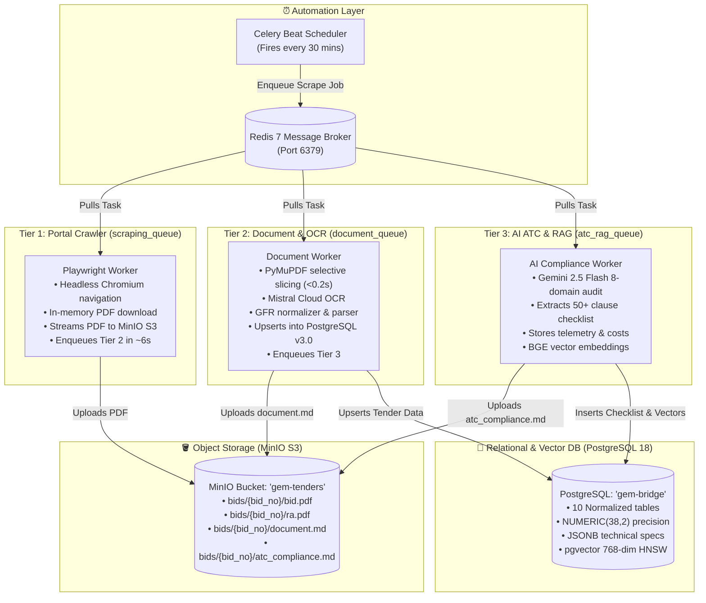

# 🚀 GeMBridge: Local Development & Server Deployment Guide

> **Target Systems:**
> - **Local Development:** Windows 10/11 (with AMD Ryzen / Intel CPU, Native Desktop PostgreSQL, Docker Desktop for Redis & MinIO, PowerShell)
> - **Production Server:** Hostinger KVM 4 VPS (Ubuntu 24.04 LTS, AMD EPYC, Dokploy / Docker Compose, Traefik)
>
> **Architecture Version:** 3.0.0 (Distributed 3-Tier Celery Engine + PostgreSQL 18 pgvector + MinIO S3)

---

## 📑 Table of Contents

1. [Architecture Overview](#1-architecture-overview)
2. [Prerequisites & System Requirements](#2-prerequisites--system-requirements)
3. [Environment Configuration (`.env`)](#3-environment-configuration-env)
4. [Local Development Setup (Step-by-Step)](#4-local-development-setup-step-by-step)
   - [Step 4.1: PostgreSQL Desktop Database Setup](#step-41-postgresql-desktop-database-setup)
   - [Step 4.2: Redis 7 Broker Container](#step-42-redis-7-broker-container)
   - [Step 4.3: MinIO S3 Object Storage Container](#step-43-minio-s3-object-storage-container)
   - [Step 4.4: Python Virtual Environment & Dependencies](#step-44-python-virtual-environment--dependencies)
   - [Step 4.5: Running Celery Workers on Windows](#step-45-running-celery-workers-on-windows)
   - [Step 4.6: Verification & Test Suite Execution](#step-46-verification--test-suite-execution)
5. [Docker Compose Alternative (Local Dev)](#5-docker-compose-alternative-local-dev)
6. [Production Server Deployment (Hostinger KVM 4 VPS)](#6-production-server-deployment-hostinger-kvm-4-vps)
   - [Server Specifications & Resource Ceilings](#server-specifications--resource-ceilings)
   - [Dokploy & Docker Compose Deployment](#dokploy--docker-compose-deployment)
   - [Production Celery Beat & Automated Crawling](#production-celery-beat--automated-crawling)
7. [Repository Clean Structure & File Map](#7-repository-clean-structure--file-map)
8. [Troubleshooting & FAQ](#8-troubleshooting--faq)

---

## 1. Architecture Overview

The **GeMBridge Pipeline** is an asynchronous, event-driven processing pipeline that continuously ingests, extracts, analyzes, and indexes government tenders from the Government e-Marketplace (GeM) portal (`bidplus.gem.gov.in`).



---

## 2. Prerequisites & System Requirements

### Hardware Requirements
| Environment | CPU | RAM | Disk | Recommended For |
|---|---|---|---|---|
| **Local Development** | AMD Ryzen / Intel Core (4+ cores) | ≥8 GB RAM | 20 GB SSD | Windows 10/11 or Ubuntu |
| **Production Server** | Hostinger KVM 4 (4 vCPU AMD EPYC) | 16 GB RAM | 200 GB NVMe | Ubuntu 24.04 LTS (Dokploy) |

### Software Prerequisites
- **Python 3.10+** (64-bit)
- **Docker Desktop** (with WSL 2 backend on Windows) or Docker Engine on Linux
- **PostgreSQL 16, 17, or 18** (with `pgvector` extension installed)
- **Git**

---

## 3. Environment Configuration (`.env`)

Create a `.env` file in the root directory by copying `.env.example`:

```bash
cp .env.example .env
```

Ensure the following variables are configured:

```ini
# =========================================================================
# GeMBridge Enterprise Environment Configuration
# =========================================================================

# Database Configuration (Native Desktop PostgreSQL)
DB_HOST=localhost
DB_PORT=5432
DB_NAME=gem-bridge
DB_USER=postgres
DB_PASSWORD=postgres
DB_MIN_CONNECTIONS=2
DB_MAX_CONNECTIONS=10

# Redis Broker & Result Backend
REDIS_HOST=localhost
REDIS_PORT=6379
REDIS_DB=0
CELERY_BROKER_URL=redis://localhost:6379/0
CELERY_RESULT_BACKEND=redis://localhost:6379/0

# MinIO S3 Object Storage
MINIO_ENDPOINT=localhost:9000
MINIO_ACCESS_KEY=minioadmin
MINIO_SECRET_KEY=minioadmin
MINIO_BUCKET_NAME=gem-tenders
MINIO_SECURE=false

# AI Services & Cloud OCR
MISTRAL_API_KEY=your_mistral_api_key_here
GEMINI_API_KEY=your_gemini_api_key_here

# Pipeline Settings
PLAYWRIGHT_HEADLESS=true
PORTAL_URL=https://bidplus.gem.gov.in/bidlists
LOG_LEVEL=INFO
```

---

## 4. Local Development Setup (Step-by-Step)

### Step 4.1: PostgreSQL Desktop Database Setup

For local Windows development, we use native desktop PostgreSQL 18.

1. **Verify or create the database `"gem-bridge"`**:
   Open PowerShell or `psql`:
   ```powershell
   psql -U postgres -h localhost -p 5432 -c "CREATE DATABASE \"gem-bridge\";"
   ```
   *(Password: `postgres`)*

2. **Enable Required Extensions**:
   ```powershell
   psql -U postgres -d "gem-bridge" -c "CREATE EXTENSION IF NOT EXISTS vector;"
   psql -U postgres -d "gem-bridge" -c "CREATE EXTENSION IF NOT EXISTS pg_trgm;"
   ```

3. **Apply the v3.0 Relational & Vector Schema**:
   Run the schema initialization script:
   ```powershell
   psql -U postgres -d "gem-bridge" -f storage/init_v3_schema.sql
   ```
   This creates all **10 optimized tables**:
   - `bids`: Master tender records with financial and lifecycle metadata.
   - `bid_items`: Individual items, quantities, and JSONB technical specifications.
   - `bid_consignees`: Delivery locations, officers, pincodes, and delivery days.
   - `bid_evaluation_schedules`: Multi-lot / item-wise schedules.
   - `bid_atc_checklist_items`: Extracted ATC compliance clauses.
   - `bid_atc_physical_submissions`: EMD, DD, or physical document deadlines.
   - `bid_hyperlinks`: Catalogs of URLs extracted from tender PDFs.
   - `bid_terms`: Decoupled heavy markdown text and disclaimers.
   - `bid_atc_analyses`: AI execution telemetry, token counts, and cost metrics.
   - `gem_bid_chunks`: 768-dimensional embeddings with an HNSW cosine index.

---

### Step 4.2: Redis 7 Broker Container

Run Redis 7 via Docker in the background:

```powershell
docker run -d `
  --name redis-server-gem `
  -p 6379:6379 `
  --restart always `
  redis:7-alpine
```

Verify that Redis is responding:
```powershell
docker exec -it redis-server-gem redis-cli ping
# Expected output: PONG
```

---

### Step 4.3: MinIO S3 Object Storage Container

Run the MinIO container using the `alpine/minio:latest-release` image with root user execution (`--user 0:0`) to ensure smooth volume permission handling:

```powershell
docker run -d `
  --name minio-server-gem `
  --user 0:0 `
  -p 9000:9000 `
  -p 9001:9001 `
  -e MINIO_ROOT_USER=minioadmin `
  -e MINIO_ROOT_PASSWORD=minioadmin `
  -v gem_minio_data:/data `
  --restart always `
  alpine/minio:latest-release server /data --console-address ":9001"
```

- **S3 API Endpoint:** `http://localhost:9000`
- **Web Console UI:** `http://localhost:9001` (Login: `minioadmin` / `minioadmin`)

---

### Step 4.4: Python Virtual Environment & Dependencies

1. **Activate virtual environment**:
   ```powershell
   .\venv\Scripts\Activate.ps1
   ```

2. **Install required packages**:
   ```powershell
   pip install -r requirements.txt
   ```

3. **Install Playwright browser binaries**:
   ```powershell
   playwright install chromium
   ```

---

### Step 4.5: Running Celery Workers on Windows

#### The Windows Concurrency Challenge
On native Windows, Celery cannot use POSIX `prefork` (multiprocessing based on `os.fork()`), which causes random deadlocks or worker crashes when attempting `-c 4`. Setting `-P solo` works stably, but a single worker process cannot handle multiple queues concurrently.

#### The Multi-Process Solution: `start_workers.ps1`
To resolve this, we provide `start_workers.ps1`. This script spawns **3 dedicated, isolated background processes**, each dedicated to its own queue with `-P solo`:
- **Worker 1 (`scraping_queue`)**: Tier 1 Playwright Crawler
- **Worker 2 (`document_queue`)**: Tier 2 Document & OCR Processor
- **Worker 3 (`atc_rag_queue`)**: Tier 3 AI ATC Compliance & Vectorization

#### Commands:
```powershell
# 1. Start all 3 isolated workers across separate CPU cores
.\start_workers.ps1

# 2. Start all workers WITH the Flower Web Monitoring Dashboard (http://localhost:5555)
.\start_workers.ps1 -WithFlower

# 3. Start all workers WITH Flower AND Celery Beat recurring scheduler (every 30 mins)
.\start_workers.ps1 -WithFlower -WithBeat

# 4. Stop all running Celery and Flower processes cleanly
.\start_workers.ps1 -Stop
```

---

### Step 4.6: Verification & Test Suite Execution

All verification and benchmark scripts are maintained under `Testing Scripts/`:

1. **Verify PostgreSQL Ingestion (All 61 bids ingested across 10 tables)**:
   ```powershell
   .\venv\Scripts\python "Testing Scripts/test_postgres_ingestion.py"
   ```
   *Expected: 61 Succeeded, 0 Failed (~1.3s total runtime).*

2. **Verify MinIO S3 Object Storage (Upload, Download, SHA256 integrity)**:
   ```powershell
   .\venv\Scripts\python "Testing Scripts/test_minio_storage.py"
   ```
   *Expected: All 5 checks pass including in-memory byte streams and presigned URLs.*

3. **Run Hardware Footprint & Live Telemetry Benchmark**:
   ```powershell
   .\venv\Scripts\python "Testing Scripts/benchmark_pipeline_usage.py"
   ```
   *Measures real-time RSS RAM and peak CPU % per worker.*

#### Benchmark Results on AMD Ryzen 5 4600H (6C/12T, 8 GB RAM):
| Worker Tier | Dedicated Queue | Steady RAM | Peak RAM | Peak CPU |
|---|---|---|---|---|
| **Tier 1: Scraper** | `scraping_queue` | ~85 MB | ~390 MB (Chromium) | 2.9% |
| **Tier 2: Document** | `document_queue` | ~75 MB | ~480 MB (PyMuPDF) | 2.9% |
| **Tier 3: ATC & RAG** | `atc_rag_queue` | ~75 MB | ~420 MB (Embeddings) | 5.8% |
| **COMBINED PIPELINE** | All 3 Tiers | **~235 MB** | **~1.29 GB** | **<6.0%** |
*Headroom remaining: >94% CPU and >6.5 GB RAM.*

---

## 5. Docker Compose Alternative (Local Dev)

If you prefer to run the entire worker cluster inside Linux Docker containers with native `prefork` instead of native Windows processes, use `docker-compose.local.yml`:

```powershell
# Build and launch Redis, MinIO, and Celery Workers
docker-compose -f docker-compose.local.yml up -d

# View worker logs
docker-compose -f docker-compose.local.yml logs -f celery_workers

# Scale workers if needed
docker-compose -f docker-compose.local.yml up -d --scale celery_workers=2

# Tear down containers
docker-compose -f docker-compose.local.yml down
```

---

## 6. Production Server Deployment (Hostinger KVM 4 VPS)

### Server Specifications & Resource Ceilings
- **Host:** Hostinger KVM 4 (`srv1701681`) — Ubuntu 24.04 LTS
- **Hardware:** 4 vCPU (AMD EPYC 9355P), 16 GB RAM, 200 GB NVMe
- **Co-Existing Containers:** 46 existing containers managed by Dokploy & Traefik
- **Total Pipeline Budget Allocation:**
  - **CPU Ceiling:** ≤ 2.5 vCPU maximum
  - **RAM Ceiling:** ≤ 2.8 GB RAM maximum

### Dokploy & Docker Compose Deployment

In Dokploy or production Docker Compose, deploy the worker service with strict CPU and memory limits:

```yaml
version: '3.8'

services:
  celery_workers:
    build:
      context: .
      dockerfile: Dockerfile
    command: >
      celery -A tasks.celery_app worker
      -Q scraping_queue,document_queue,atc_rag_queue
      -c 6
      -P prefork
      --max-tasks-per-child=100
      --loglevel=INFO
    environment:
      - DB_HOST=postgres_container
      - DB_PORT=5432
      - DB_NAME=gem-bridge
      - DB_USER=${PROD_DB_USER}
      - DB_PASSWORD=${PROD_DB_PASS}
      - CELERY_BROKER_URL=redis://redis_container:6379/0
      - CELERY_RESULT_BACKEND=redis://redis_container:6379/0
      - MINIO_ENDPOINT=minio_container:9000
      - MINIO_ACCESS_KEY=${PROD_MINIO_KEY}
      - MINIO_SECRET_KEY=${PROD_MINIO_SECRET}
    deploy:
      resources:
        limits:
          cpus: '2.50'
          memory: 2800M
        reservations:
          cpus: '0.50'
          memory: 512M
    restart: always

  celery_beat:
    build:
      context: .
      dockerfile: Dockerfile
    command: celery -A tasks.celery_app beat --loglevel=INFO
    environment:
      - CELERY_BROKER_URL=redis://redis_container:6379/0
    restart: always
```

### Production Celery Beat & Automated Crawling
`tasks/beat_schedule.py` automatically registers a recurring 30-minute interval job:
- Triggers `tasks.tier1_scraper.crawl_category_task`.
- Scrapes the latest tender batches and deduplicates against Redis key `gem:seen:{safe_bid_no}` with a 7-day TTL.
- Eliminates redundant downloads and preserves Mistral / Gemini API credits.

---

## 7. Repository Clean Structure & File Map

```
Scrapper & RAG Pipeline/
├── config/
│   ├── __init__.py
│   └── settings.py               # Pydantic / dataclass settings & env loader
├── core/
│   ├── browser.py                # Playwright automation & in-memory PDF streaming
│   ├── normalizer.py             # Indian financial & date normalization
│   ├── parser.py                 # Multi-item & schedule parser
│   └── pdf_splitter.py           # Selective PyMuPDF slicer
├── Documentation/
│   ├── ARCHITECTURE_FLOW.md      # Detailed workflow specification
│   ├── ER-Diagram-V3.md          # Full v3.0 database entity documentation
│   ├── SERVER_DEPLOYMENT_PLAN.md # VPS hardware audit & deployment blueprint
│   └── SETUP_AND_DEPLOYMENT_GUIDE.md # This comprehensive guide
├── storage/
│   ├── init_v3_schema.sql        # Standard PostgreSQL DDL for 10 tables + pgvector
│   └── postgres_db.py            # ThreadedConnectionPool & atomic upsert logic
├── tasks/
│   ├── celery_app.py             # Celery application & queue definitions
│   ├── tier1_scraper.py          # Tier 1: Crawling & MinIO streaming
│   ├── tier2_document.py         # Tier 2: OCR, Slicing, DB upsert
│   ├── tier3_atc_rag.py          # Tier 3: AI compliance & vectorization
│   └── beat_schedule.py          # Recurring 30-minute schedule definition
├── Testing Scripts/
│   ├── benchmark_pipeline_usage.py # Real-time CPU/RAM telemetry benchmark
│   ├── test_all_phases.py        # End-to-end integration test runner
│   ├── test_minio_storage.py     # MinIO S3 operations verification
│   ├── test_ocr_providers.py     # Mistral OCR connectivity check
│   └── test_postgres_ingestion.py # Bulk tender ingestion verification (61 bids)
├── utils/
│   └── s3_storage.py             # MinIO S3 wrapper (in-memory streaming)
├── .env.example                  # Environment variable template
├── .gitignore                    # Optimized ignore rules for v3
├── docker-compose.local.yml      # Local Linux Docker Compose
├── Dockerfile                    # Production container image definition
├── requirements.txt              # Complete Python dependency manifest
├── SERVER_DEPLOYMENT_PLAN.md     # VPS architecture blueprint
├── SETUP_AND_DEPLOYMENT_GUIDE.md # Root shortcut to setup guide
└── start_workers.ps1             # Local Windows multi-worker launcher
```

---

## 8. Troubleshooting & FAQ

### Q1: `psycopg2.OperationalError: password authentication failed`
- **Solution:** Verify the `DB_PASSWORD` in `.env`. The default desktop password is `postgres`. If your local setup uses a different password, update `.env` accordingly.

### Q2: `minio.error.S3Error: AccessDenied` or permission errors on `/data`
- **Solution:** MinIO requires root write permissions when binding Docker volumes on Windows. Ensure `--user 0:0` is passed during `docker run` or specified in `docker-compose.yml`.

### Q3: Celery worker hangs or deadlocks on Windows with `-c 4`
- **Solution:** Do not use prefork (`-c 4`) on native Windows. Run `.\start_workers.ps1`, which launches 3 independent `-P solo` processes assigned to distinct queues. This delivers full process isolation without WSL 2 overhead.

### Q4: `numeric field overflow` on EMD or financial amounts
- **Solution:** Older schemas used `NUMERIC(15,2)` which truncated 24-digit abnormal bid numbers (e.g. `GEM_2026_B_8103567`). The v3.0 schema sets all monetary and quantity columns to `NUMERIC(38,2)` to prevent overflow.

---
*Maintained by GeMBridge Engineering Team.*
