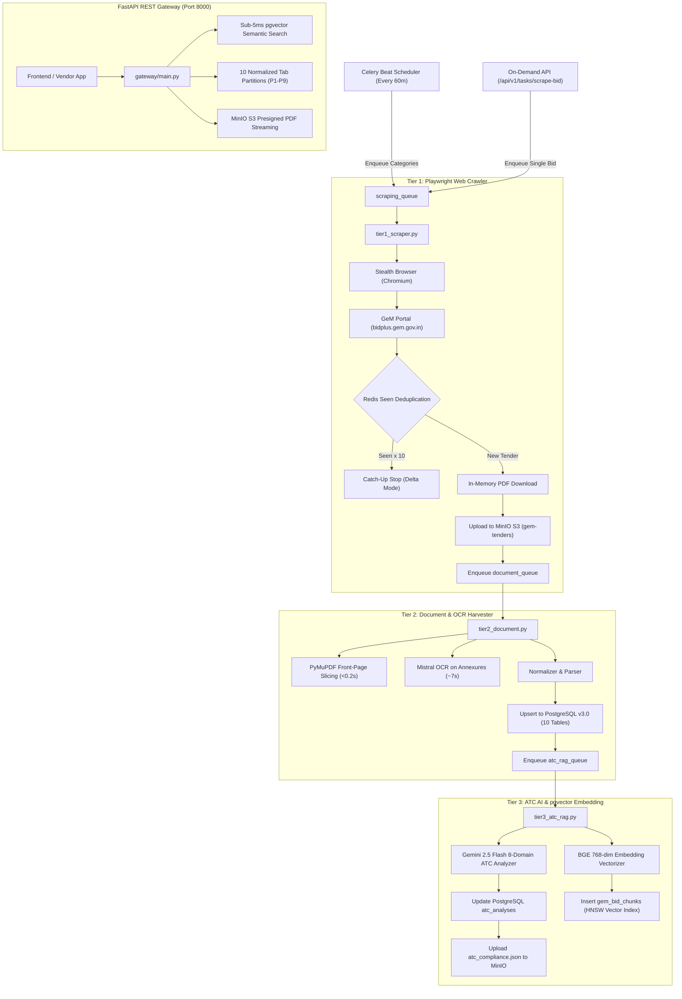

# 🧠 brain.md — GeMBridge Master System Blueprint & Architecture

> **Last Updated:** October 2026 (v3.0 Production Distributed Pipeline)  
> **Originating Specification:** [`C:\Users\Darshan\Downloads\GeM.md`](file:///C:/Users/Darshan/Downloads/GeM.md)  
> **API & Schema References:**  
> - API Requests & Live JSON Guide: [`Documentation/API_REQUESTS_AND_RESPONSES.md`](file:///F:/Projects/gem_scraper/Documentation/API_REQUESTS_AND_RESPONSES.md)  
> - API Specification & Partition Guide: [`Documentation/API_SPECIFICATION_AND_PARTITION_GUIDE.md`](file:///F:/Projects/gem_scraper/Documentation/API_SPECIFICATION_AND_PARTITION_GUIDE.md)  
> - Normalized Database Schema: [`Documentation/ER-Diagram-V3.md`](file:///F:/Projects/gem_scraper/Documentation/ER-Diagram-V3.md)  
> - Implementation Tracker: [`chnages.md`](file:///F:/Projects/gem_scraper/chnages.md)  

---

## 🧭 1. Executive Summary & Platform Purpose

**GeMBridge** is an enterprise AI procurement intelligence platform built to help Indian manufacturers, vendors, and service contractors discover, analyze, qualify for, and win public procurement bids on the **Government e-Marketplace (GeM)** (`bidplus.gem.gov.in`).

The platform bridges the gap between raw, unstructured government tender documents and vendor decision-making through a 3-tier distributed microservice pipeline:

```
┌───────────────────────────────────────────────────────────────────────────────────────────────────┐
│                                   GeMBridge Production Architecture                               │
│                                                                                                   │
│   ┌───────────────────────────────────────────────┐     FastAPI v3.0     ┌─────────────────────┐  │
│   │        gem_scraper (AI & Data Pipeline)       │      REST Gateway    │  GEM App (Platform) │  │
│   │        F:\Projects\gem_scraper\               │      (Port 8000)     │  F:\Projects\GEM\   │  │
│   │                                               │  ──────────────────► │                     │  │
│   │  • Tier 1: Playwright Stealth Crawler         │                      │  • Django REST API  │  │
│   │    (Delta Scraping + Redis Deduplication)     │  ◄────────────────── │  • Next.js 16 UI    │  │
│   │  • Tier 2: PyMuPDF + Mistral OCR Harvester    │     Celery Dispatch  │  • 9-Step Onboarding│  │
│   │  • Tier 3: Gemini 2.5 Flash 8-Domain ATC AI   │     /api/v1/tasks/   │  • Vendor Profiles  │  │
│   │  • Storage: PostgreSQL v3.0 + MinIO S3        │                      │  • Eligibility Match│  │
│   │  • Search: BGE 768-dim pgvector HNSW Index    │                      │  • Bid Marketplace │  │
│   └───────────────────────────────────────────────┘                      └─────────────────────┘  │
└───────────────────────────────────────────────────────────────────────────────────────────────────┘
```

---

## 🏛️ 2. GeM Domain Knowledge Base & Taxonomy (from `GeM.md`)

[`GeM.md`](file:///C:/Users/Darshan/Downloads/GeM.md) provides the complete domain taxonomy of Indian Government procurement rules under GFR (General Financial Rules) and GeM Guidelines:

### A. The 10 Types of GeM Bids
1. **All Bid/RAs:** Global unfiltered listing of all live portal bids.
2. **Product Bid/RAs:** Standard procurement for physical goods available in the GeM catalogue.
3. **Service Bid/RAs:** Services such as Manpower, Security, Facility Management, IT Support, Consulting.
4. **Bid to RA:** Two-stage procurement:
   - *Stage 1:* Technical evaluation and qualification.
   - *Stage 2:* Automated Reverse Auction (RA) conducted among qualified bidders.
5. **Product Custom Bid/RAs:** Procurement for items missing from the standard GeM catalogue; requires generation of a **GeMARPTS** (GeM Availability Report & Past Transaction Summary).
6. **BOQ Bids (Bill of Quantities):** Configured when bids have $>5$ line items (consumables/spare parts) valued $> ₹5$ Lakhs. Evaluation can be Total-value-wise, Item-wise, or Group-wise.
7. **Rate Contract Bids (RC):** Standing framework agreements fixing rates and terms once; multiple purchase orders placed repeatedly during the contract tenure without fresh tenders.
8. **Global Tender (GTE):** High-value or technology-intensive procurement open to international suppliers.
9. **Limited Tender Enquiry (Rule 162 GFR):** Restricted competition directly inviting $\ge 3$ pre-approved suppliers.
10. **Single Tender Enquiry (Rule 166 GFR):** Proprietary or emergency procurement from a sole source.

### B. The 3 Primary Bidding Processes
- **Catalogue Bidding:** Catalogue items configured using GeM "Golden Parameters" and bunch bidding options.
- **BoQ Bidding:** Spare parts/consumables with detailed BoQ specification sheets; prohibited for bids below ₹5 Lakhs.
- **Custom Bidding:** Custom specifications uploaded after preparing a custom catalogue (selecting up to 3 similar categories).

### C. The 8-Pillar General Questionnaire
Every tender parsed by GeMBridge extracts and answers:
1. **Identity & Classification:** Bid Number, RA Number, Product vs Service, Process Kind (Catalogue/BoQ/Custom), Tender Mode.
2. **Scope of Procurement:** Item category/subcategories, single vs bunch/multi-item BoQ.
3. **Competition Structure:** Single-Packet vs Two-Packet bid, Evaluation method (Total/Item/Group), Bid splitting rules, Auto-extension rules.
4. **Eligibility & Qualifications:** Past experience years, Minimum average annual turnover, MSE / Startup relaxations, required seller documents.
5. **Financial Terms & Instruments:** EMD requirement/amount/bank, ePBG percentage/duration/bank, estimated bid value.
6. **Timelines & Milestones:** Start datetime, End datetime, Opening datetime, Bid validity days, Technical clarification window.
7. **Consignees & Delivery:** Locations, pincodes, quantities, and delivery schedule days.
8. **Policy / Preference / Compliance:** Make in India (MII) price band (L1+X%) and quantity %, MSE preference band and quantity %, Land Border sharing restrictions (GTC Clause 26), and Buyer Added ATC clauses.

---

## 📋 3. Comprehensive Field $\rightarrow$ Source Mapping (HTML Card vs. PDF)

Based on the 17-section mapping in [`GeM.md`](file:///C:/Users/Darshan/Downloads/GeM.md):

| # | Domain Section | Key Fields | Source in HTML Card | Source in Bid Document PDF |
|:---:|:---|:---|:---|:---|
| **1** | **Core Bid & Card** | `bid_no`, `ra_no`, `bid_type`, `product_type`, `base_type`, `process_kind` | Card header, link text, category tag | Header block / Watermark |
| **2** | **Card Items & Depts** | `card.items[]`, `card.departments[]` | "Items", "Quantity", "Department Name And Address" | First page buyer detail |
| **3** | **Timing Details** | `start_date`, `end_date`, `bid_end_datetime`, `bid_opening_datetime`, `bid_offer_validity_days` | Card start/end text | Rows: "Bid End Date/Time", "Bid Opening Date/Time", "Bid Offer Validity" |
| **4** | **Department Hierarchy** | `ministry_state_name`, `department_name`, `organisation_name`, `office_name` | Top card line | Rows: "Ministry/State Name", "Department Name", "Organisation Name", "Office Name" |
| **5** | **Items & Schedules** | `schedule_no`, `item_category`, `quantity` | Card Items block | Schedule table / "Total Quantity" row |
| **6** | **Seller Documents** | `required_from_seller[]`, `show_uploaded_docs_to_all_bidders`, attachments | N/A | Row: "Document required from seller" (comma-separated), Attachment list |
| **7** | **Consignees** | `consignee_name`, `address_raw`, `pincode`, `city`, `state`, `quantity`, `delivery_days` | N/A | Table: "Consignees/Reporting Officer" |
| **8** | **Relaxations** | `mse_relaxation_experience_turnover`, `startup_relaxation_experience_turnover` | N/A | Rows: "MSE Relaxation...", "Startup Relaxation..." |
| **9** | **Auto Extension** | `min_bids_to_disable_extension`, `auto_extend_days`, `auto_extension_count` | N/A | Rows: "Minimum number of bids required...", "Number of days...", "Number of Auto Extension count" |
| **10** | **Reverse Auction** | `bid_to_ra_enabled`, `ra_qualification_rule` | N/A | Rows: "Bid to RA enabled", "RA Qualification Rule" |
| **11** | **Packet & Clarification** | `type_of_bid`, `technical_clarification_window_days` | N/A | Rows: "Type of Bid", "Time allowed for Technical Clarifications..." |
| **12** | **Inspection** | `inspection_required`, `inspection_agency_type` | N/A | Row: "Inspection Required (By Empanelled Inspection Authority...)" |
| **13** | **Evaluation Method** | `evaluation_method`, `schedules[]` | N/A | Row: "Evaluation Method" (Total value wise / Item wise / Group wise) |
| **14** | **Legal Clauses** | `arbitration_clause`, `mediation_clause`, Land border restriction | N/A | Rows: "Arbitration Clause", "Mediation Clause", GTC Clause 26 |
| **15** | **MII Preference** | `mii_purchase_preference`, `mii_price_band_percent` (L1+X%), `mii_max_quantity_percent` | N/A | Rows: "MII Purchase Preference", "Purchase Preference to MII sellers...", "Maximum Percentage..." |
| **16** | **MSE Preference** | `mse_purchase_preference`, `mse_price_band_percent` (L1+X%), `mse_max_quantity_percent` | N/A | Rows: "MSE Purchase Preference", "Purchase Preference to MSE OEMs...", "Maximum Percentage..." |
| **17** | **Financials (EMD/ePBG)**| `emd.required`, `emd.amount_total`, `advisory_bank`, `epbg.percent`, `epbg.duration_months` | N/A | Sections: "EMD Detail" and "ePBG Detail" |
| **18** | **Terms & ATC** | `special_terms_text`, `buyer_atc.generic`, `buyer_atc.items[]`, `buyer_atc.hard_requirements[]` | N/A | Sections: "Special terms and conditions", "Buyer Added Bid Specific Terms and Conditions" |

---

## 🏗️ 4. System Deep-Dive: 3-Tier Distributed Architecture

The system operates across three dedicated independent OS processes managed via Celery and Redis:



### Tier Descriptions:
* **Tier 1 (Scraper Worker — `scraping_queue`):**  
  Automates Playwright stealth browsing. Checks Redis deduplication key (`gem:seen:{safe_bid_no}`). In 24/7 Delta Mode (`TARGET_PER_TYPE=0`), it fetches all new tenders and stops when encountering `MAX_CONSECUTIVE_SEEN=10` previously seen tenders in reverse-chronological order. Downloads PDFs and streams directly to MinIO S3. Releases browser context in ~6s.
* **Tier 2 (Document Worker — `document_queue`):**  
  Streams PDF from MinIO into memory. Performs ultra-fast PyMuPDF structural slicing (<0.2s) for front-page data and delegates heavy scanned pages to Mistral OCR. Normalizes all metadata and executes full ACID upsert across PostgreSQL v3.0 tables.
* **Tier 3 (ATC & RAG Worker — `atc_rag_queue`):**  
  Invokes Gemini 2.5 Flash 8-domain compliance analysis to categorize mandatory documents, exemptions, delivery penalties, and physical submission deadlines. Chunks the tender into domain passages, computes 768-dimensional BGE embeddings, and populates `gem_bid_chunks` with HNSW cosine distance indexing (`<=>`).

---

## ⚡ 5. FastAPI REST Gateway (Port 8000)

The REST API Gateway provides sub-5ms unified access to procurement intelligence across 7 modules.

* **Base URL:** `http://localhost:8000`
* **Swagger UI Documentation:** `http://localhost:8000/docs`
* **ReDoc Specification:** `http://localhost:8000/redoc`
* **Complete Live Request & Response Reference:** [`Documentation/API_REQUESTS_AND_RESPONSES.md`](file:///F:/Projects/gem_scraper/Documentation/API_REQUESTS_AND_RESPONSES.md)

### Gateway Route Summary:
1. **Health Check:** `GET /health`
2. **Master Tenders:**  
   - `GET /api/v1/bids` (Paginated, multi-field filters)  
   - `GET /api/v1/bids/{bid_no}` (Complete exhaustive master dossier)  
   - `GET /api/v1/bids/{bid_no}/raw` (Original raw scraped JSON backup)
3. **Sub-Resource Partitions (P1–P9):**  
   - `/header` (Lifecycle, validity days, status)  
   - `/buyer` (Ministry, department, organization)  
   - `/items` (Quantities, item category, technical specifications JSONB)  
   - `/consignees` (Delivery locations, pincodes, turnaround days)  
   - `/financials` (Estimated value, EMD amount, advisory bank)  
   - `/policy` (MSE price band %, Startup relaxation, MII Class 1/2)  
   - `/documents` (Mandatory seller upload checklist)  
   - `/atc` (Gemini AI 8-domain structured compliance checklist)  
   - `/submissions` (Offline physical submissions, DD/bank guarantee instructions)
4. **Discovery & Aggregations:**  
   - `GET /api/v1/types` (Breakdown across all 9 bid types)  
   - `GET /api/v1/organizations` (Top procuring departments)  
   - `GET /api/v1/locations/states` (State-level pipelines)  
   - `GET /api/v1/locations/pincode/{pin}/bids` (Freight logistics explorer)
5. **Search & AI:**  
   - `GET /api/v1/search/quick` (Auto-complete)  
   - `GET /api/v1/search/keyword` (Fuzzy pg_trgm matching)  
   - `POST /api/v1/search/semantic` (Sub-5ms 768-dim BGE vector search)
6. **Document Streaming:**  
   - `GET /api/v1/documents/{bid_no}/pdf` (MinIO S3 15-min presigned URL or HTTP 307 redirect)
7. **Celery Task Operations:**  
   - `POST /api/v1/tasks/scrape-bid` (On-demand crawl)  
   - `POST /api/v1/tasks/scrape-category` (Category portal crawl)  
   - `GET /api/v1/tasks/{task_id}` (Real-time worker polling)
8. **Telemetry & KPIs:**  
   - `GET /api/v1/analytics/overview` (Total tenders, active pipeline INR value)  
   - `GET /api/v1/analytics/ai-telemetry` (Tokens, latency, costs in USD & INR)

---

## 🚦 6. Implementation Status & Master Matrix

| # | Feature / Module | Architectural Spec | Current Status | Verification State |
|:---:|:---|:---|:---:|:---:|
| **1** | **PostgreSQL v3.0 Schema** | 10 Relational Tables + pgvector HNSW | ✅ **DONE** | Verified on live DB |
| **2** | **MinIO S3 Object Storage** | In-memory upload + Presigned streaming | ✅ **DONE** | Verified on MinIO port 9000 |
| **3** | **Celery 3-Tier Distributed Queue** | Isolated queues (`scraping`, `document`, `atc_rag`) | ✅ **DONE** | 46+ tasks verified |
| **4** | **Celery Beat Periodic Scheduler** | Hourly cron crawler (`*/60 * * * *`) | ✅ **DONE** | Verified with dynamic target |
| **5** | **Flower Web Dashboard** | Task telemetry monitor on port 5555 | ✅ **DONE** | Operational at `localhost:5555` |
| **6** | **FastAPI REST API Gateway** | Port 8000, 7 modules, Swagger UI | ✅ **DONE** | 100% 200 OK responses |
| **7** | **Windows Proactor Fix** | Resolves Flower + Playwright conflict | ✅ **DONE** | Verified on Windows 11 |
| **8** | **24/7 Delta Scraping Engine** | Deduplication + Consecutive seen threshold | ✅ **DONE** | Configurable via `.env` |
| **9** | **Complete API Guide & Output** | Documentation with live JSON outputs | ✅ **DONE** | `Documentation/API_...` |
| **10**| **Hostinger VPS Dokploy Deploy** | Ubuntu 24.04 Production Docker Compose | ⏳ **READY** | `docker-compose.prod.yml` |

---

## 🏃 7. Operational Cheat-Sheet (Commands)

### Windows Local Pipeline Launcher
```powershell
# Start all 3 worker tiers + Celery Beat + Flower Dashboard + FastAPI Gateway
.\start_workers.ps1 -WithGateway -WithBeat -WithFlower

# Start only workers & Gateway
.\start_workers.ps1 -WithGateway

# Stop all background worker processes
.\start_workers.ps1 -Stop
```

### Linux / WSL Pipeline Launcher
```bash
# Make script executable
chmod +x start_workers.sh

# Start all workers, scheduler, flower, and gateway with -c 6 concurrency capping
./start_workers.sh -WithGateway -WithBeat -WithFlower

# Tail logs live
tail -f logs/*.log

# Stop all background workers
./start_workers.sh -Stop
```

### Direct Service URLs
- **FastAPI Interactive Swagger Docs:** `http://localhost:8000/docs`
- **FastAPI ReDoc Specification:** `http://localhost:8000/redoc`
- **Celery Flower Dashboard:** `http://localhost:5555`
- **MinIO Storage Console:** `http://localhost:9001` (Credentials: `minioadmin` / `minioadmin`)

---

*GeMBridge Master Blueprint — Authoritative architectural document for GeMBridge v3.0.*
