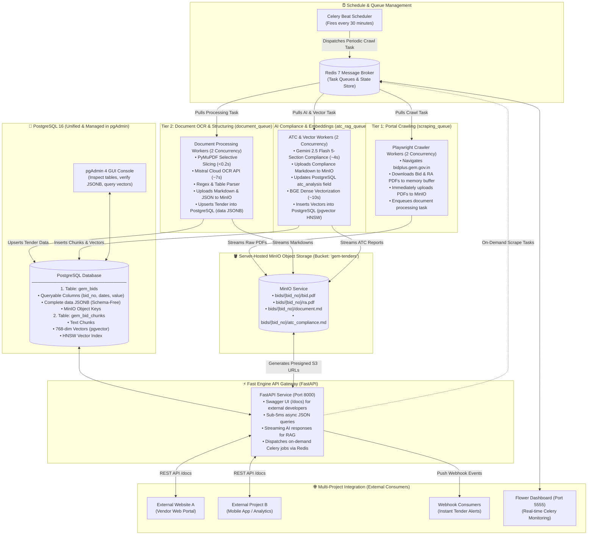
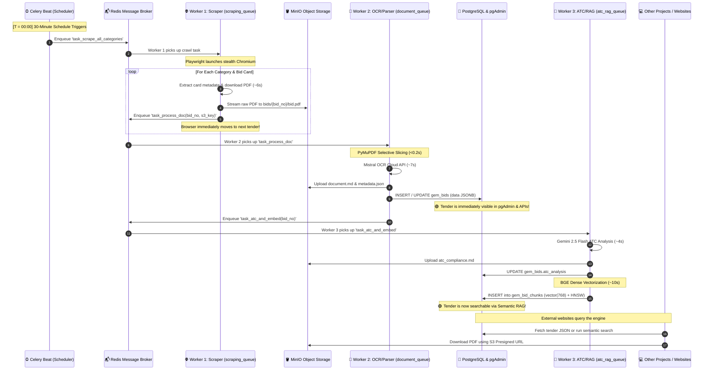

# 🏛️ GeMBridge: Finalized Production Server Architecture & Worker Deployment Plan

---

## 1. Executive Blueprint: Finalized System Architecture

This blueprint documents the production-grade architecture of the **GeMBridge Data Engine** for Linux / Ubuntu VPS deployment. The system consolidates all physical files into server-hosted **MinIO** object storage, unifies all structured tender data and semantic vector embeddings into **PostgreSQL** (managed visually via **pgAdmin**), and decouples workloads into an asynchronous **3-tier Celery queue** executing on a recurring **30-minute schedule**, fronted by a high-performance **FastAPI** gateway for multi-project data sharing.

### 📐 Finalized Target System Blueprint



---

## 2. Complete Production Technology Stack

| Layer / Domain | Technology & Framework | Purpose & Implementation Role |
| :--- | :--- | :--- |
| **Server OS & Environment** | **Ubuntu Linux (22.04 LTS / Hostinger KVM 4)** | Host operating system with kernel swap cushioning, POSIX process management, and headless graphics libraries. |
| **Containerization & Orchestration** | **Docker & Docker Compose** | Containerized microservice topology isolating workers, database, cache, and monitoring tools. |
| **Web Crawling & Anti-Bot Evasion** | **Playwright (Python)** | Headless Chromium automation with anti-bot evasion, dynamic JavaScript DOM evaluation, and randomized user-agent/viewport pools. |
| **Document Harvesting & Slicing** | **PyMuPDF (`fitz`)** | High-speed PDF hyperlink extraction, table boundary identification, and selective ATC page slicing (cutting 30%-50% of OCR overhead). |
| **Document OCR Engine** | **Mistral OCR Cloud API (`mistral-ocr-3-0`)** | High-fidelity document conversion into Markdown, retaining complex nested Indian Government procurement tables and formatting. |
| **AI Compliance Engine** | **Google Gemini 2.5 Flash** *(Fallback: GPT-4o-mini)* | Zero-shot 5-section Buyer ATC compliance analysis (EMD/ePBG, technical qualifications, mandatory uploads, exemptions, commercial terms). |
| **Dense Vector Embeddings** | **BAAI/bge-base-en-v1.5 (Hugging Face / PyTorch)** | 768-dimensional dense semantic vectors tuned for technical, commercial, and procurement specifications. |
| **Cross-Encoder Reranker** | **BAAI/bge-reranker-base (Sentence-Transformers)** | Deep cross-encoder reranking of top search candidates to maximize hybrid retrieval precision. |
| **Relational & JSON Database** | **PostgreSQL 16 (`JSONB`)** | ACID primary database storing high-level columns for fast sorting/pagination alongside the complete schema-free tender payload (`data JSONB`). |
| **Vector Database Extension** | **`pgvector` (PostgreSQL Extension)** | Native vector similarity engine using Hierarchical Navigable Small World (HNSW) indexing with cosine distance (`<=>`). |
| **Database Management GUI** | **pgAdmin 4** | Web-based visual console to inspect tender rows, review JSONB documents, monitor HNSW indexes, and test SQL queries. |
| **Object Storage** | **MinIO (Server-Hosted, S3-Compatible)** | Persistent object storage for Bid PDFs, RA PDFs, Markdown files, and JSON artifacts; issues time-limited S3 Presigned URLs. |
| **Task Queue & Message Broker** | **Celery + Redis 7** | Distributed asynchronous task queue separating workloads into `scraping_queue`, `document_queue`, and `atc_rag_queue`. |
| **Periodic Scheduler** | **Celery Beat** | Background clock daemon triggering recurring scrape cycles every 30 minutes without CPU overhead. |
| **Queue Monitoring Dashboard** | **Flower** | Real-time web dashboard for Celery worker tracking, queue depths, task latencies, and retry telemetry. |
| **Engine REST API Gateway** | **FastAPI / Uvicorn (Python 3.11+)** | High-performance asynchronous ASGI REST API exposing auto-documented Swagger endpoints (`/docs`) to external projects. |
| **Vendor Web Application** | **Django 5.1.4 REST Backend + Next.js 16 Frontend** | Vendor onboarding audit wizard, readiness scoring, and dual-view tender exploration interface. |

---

## 3. How the Workers Are Implemented

Instead of a single monolithic script that runs sequentially, the workload is distributed into **three specialized Celery worker queues** communicating through **Redis**. Each queue handles a specific resource type (Browser RAM, Cloud Network I/O, or CPU Vectorization), preventing bottlenecks and eliminating server crashes.

### 3.1 The Three Specialized Worker Queues

#### 1. Tier 1: Scraper Workers (`scraping_queue`)
* **Role:** Dedicated Playwright headless Chromium crawlers.
* **Responsibilities:**
  - Navigates the GeM portal (`bidplus.gem.gov.in`) using anti-bot stealth parameters.
  - Applies filters across all bid categories (Product, Service, BOQ, Custom, etc.).
  - Extracts card metadata, downloads the Bid PDF and RA PDF into a temporary scratch buffer, and streams them immediately into **MinIO**.
  - Dispatches a task to Redis for the next tier and **immediately frees the browser** to scrape the next tender.
* **Concurrency:** **2 Workers**.
* **Memory Target:** ~400 MB per process (~800 MB total).
* **Process Recycling:** Browser processes are configured to restart after every 20 completed tenders to flush any internal Chromium memory cache.

#### 2. Tier 2: Document Processing & OCR Workers (`document_queue`)
* **Role:** Lightweight document parsing and Cloud OCR client.
* **Responsibilities:**
  - Slices the PDF using PyMuPDF to isolate core technical pages and skip repetitive legal boilerplate.
  - Sends the core pages to the Mistral OCR Cloud API.
  - Reassembles the high-fidelity Markdown and parses structured fields (departments, consignees, quantities, financial values).
  - Streams `document.md` and `metadata.json` to **MinIO**.
  - Upserts the tender record into PostgreSQL `gem_bids`, saving the full parsed document inside the `data JSONB` column.
  - *At this moment, the tender is fully live and queryable in pgAdmin and external applications.*
* **Concurrency:** **2 Workers**.
* **Memory Target:** ~200 MB per process (~400 MB total).

#### 3. Tier 3: AI Compliance & Vector Embeddings Workers (`atc_rag_queue`)
* **Role:** AI compliance auditing and semantic vector embedding.
* **Responsibilities:**
  - Calls Gemini 2.5 Flash with the domain rulebook to extract the 5-section compliance checklist (EMD/ePBG, technical qualifications, mandatory uploads, physical submissions, and commercial terms).
  - Uploads `atc_compliance.md` to **MinIO** and updates the PostgreSQL record.
  - Chunks the document into overlapping semantic passages.
  - Generates 768-dimensional dense vectors using the `BAAI/bge-base-en-v1.5` model.
  - Inserts the vectors directly into PostgreSQL table `gem_bid_chunks` with an HNSW cosine similarity index.
* **Concurrency:** **2 Workers**.
* **Memory Target:** ~450 MB per process (~900 MB total, keeping model weights warm in memory).

#### 4. The Conductor: Celery Beat Scheduler
* **Role:** Ultra-lightweight background clock daemon.
* **Responsibilities:** Fires a crawl trigger every **30 minutes**, enqueuing the scrape cycle to Redis without consuming measurable CPU or RAM (~60 MB).

---

### 3.2 Worker Concurrency & Memory Budget Summary

```
┌───────────────────────────┬──────────────┬──────────────┬──────────────┐
│ Worker Tier               │ Concurrency  │ RAM / Worker │ Total Memory │
├───────────────────────────┼──────────────┼──────────────┼──────────────┤
│ Tier 1: Scraper           │ 2 Workers    │ ~400 MB      │ ~800 MB      │
│ Tier 2: Document/OCR      │ 2 Workers    │ ~200 MB      │ ~400 MB      │
│ Tier 3: ATC & pgvector    │ 2 Workers    │ ~450 MB      │ ~900 MB      │
│ Celery Beat Scheduler     │ 1 Daemon     │ ~60 MB       │ ~60 MB       │
├───────────────────────────┼──────────────┼──────────────┼──────────────┤
│ TOTAL SYSTEM LOAD         │ 6 Processes  │ —            │ ~2.16 GB RAM │
└───────────────────────────┴──────────────┴──────────────┴──────────────┘
```
> **Server Safety Guarantee:** Consuming only ~2.16 GB of RAM leaves **13+ GB of free memory** on a 16 GB server, ensuring absolute safety from Linux Out-Of-Memory (OOM) process termination.

---

## 4. Exact Lifecycle of How the Server Runs Every 30 Minutes

The entire system operates as a continuous, automated assembly line. Below is the precise chronological sequence of events occurring every 30 minutes.

### 🔄 30-Minute Lifecycle Sequence Diagram



---

### ⏱️ Timeline of a Single Tender from Discovery to Storage

```
Time Marker   Milestone Event                                             System State
─────────────────────────────────────────────────────────────────────────────────────────────────
T + 00:00     Worker 1 discovers new tender on GeM portal card list.       Crawling active
T + 00:06     PDF downloaded to memory buffer & streamed to MinIO.         Stored in MinIO
T + 00:07     Worker 1 dispatches task to Redis & moves to next tender.    Browser freed!
T + 00:08     Worker 2 slices PDF with PyMuPDF (< 0.2 seconds).           Boilerplate removed
T + 00:15     Mistral Cloud OCR returns high-fidelity Markdown.            OCR finished
T + 00:16     Tender metadata & full payload upserted to PostgreSQL.      🟢 Live in pgAdmin!
T + 00:20     Worker 3 completes Gemini ATC compliance analysis.           ATC finished
T + 00:26     Text chunks embedded with BGE & stored with HNSW index.     🟢 RAG Search Ready!
─────────────────────────────────────────────────────────────────────────────────────────────────
TOTAL TIME:   Only 26 seconds from portal discovery to fully queryable across all databases!
```

---

### 🛡️ Failure Isolation & Auto-Recovery Mechanics

* **If Mistral OCR or Gemini API Experiences Latency:**  
  The Playwright crawler is **never paused**. It continues crawling at full speed and filling the Redis queue. Tasks simply queue up in Redis and process as API responses return.
* **If a Playwright Browser Hangs or Crashes:**  
  Celery automatically kills the child process, spawns a clean browser instance, and retries the specific tender without interrupting any other running worker.
* **If the Server Boots or Restarts:**  
  Redis persists the message queue to disk. When the system restarts, workers resume processing right where they left off without missing or duplicating tenders.

---

## 5. Why PostgreSQL with `pgvector` is Vastly Superior to ChromaDB

For an enterprise server deployment where you already have PostgreSQL and pgAdmin hosted, **PostgreSQL with `pgvector` is far superior to ChromaDB**.

### 📊 Comparative Analysis

```
┌──────────────────────────────┬──────────────────────────────┬──────────────────────────────┐
│ Feature / Capability         │ PostgreSQL 16 + pgvector     │ Standalone ChromaDB          │
│                              │ (Managed in pgAdmin) 🥇      │ (Local Disk / Container) ❌  │
├──────────────────────────────┼──────────────────────────────┼──────────────────────────────┤
│ 1. Graphical Management      │ Full visual GUI in pgAdmin   │ No official GUI; requires    │
│                              │ (inspect rows, edit, query)  │ custom code or 3rd-party UI  │
├──────────────────────────────┼──────────────────────────────┼──────────────────────────────┤
│ 2. System Architecture       │ 1 Unified Database Engine    │ 2 Separate Databases         │
│                              │ (Relational + JSONB + Vector)│ (PostgreSQL + ChromaDB)      │
├──────────────────────────────┼──────────────────────────────┼──────────────────────────────┤
│ 3. Hybrid Search Power       │ Native SQL: Join filters,    │ Primitive metadata filters;  │
│                              │ dates, price & vector in 1Q  │ slow on complex conditions   │
├──────────────────────────────┼──────────────────────────────┼──────────────────────────────┤
│ 4. Server RAM Footprint      │ 0 MB extra RAM               │ Consumes 400 MB – 800 MB     │
│                              │ (Reuses Postgres buffers)    │ additional VPS memory        │
├──────────────────────────────┼──────────────────────────────┼──────────────────────────────┤
│ 5. Backup & Recovery         │ Standard 1-click pg_dump     │ Complex multi-storage sync;  │
│                              │ guarantees snapshot ACID     │ risk of orphaned vectors     │
├──────────────────────────────┼──────────────────────────────┼──────────────────────────────┤
│ 6. Multi-Project Access      │ Standard PostgreSQL drivers  │ Requires proprietary         │
│                              │ for Node, Python, PHP, Go    │ ChromaDB client library      │
└──────────────────────────────┴──────────────────────────────┴──────────────────────────────┘
```

### Key Architectural Advantages:

1. **Everything Under One Roof in pgAdmin:**
   You open pgAdmin in your browser and see both tables side by side:
   - `gem_bids`: Containing the human-readable columns and the complete `data JSONB` document.
   - `gem_bid_chunks`: Containing the 768-dimensional vector embeddings with HNSW indexing.
2. **Unified Relational & Semantic Queries:**
   In ChromaDB, filtering by multiple criteria (such as *closing date > today*, *estimated value > ₹50 Lakhs*, and *product type = 'Product'*) before vector search is slow and awkward. In PostgreSQL, the query optimizer evaluates relational indexes and the vector HNSW index simultaneously in a single query plan.
3. **Data Integrity & Consistency:**
   With ChromaDB, deleting or updating a tender requires synchronizing two separate databases. In PostgreSQL, foreign keys (`ON DELETE CASCADE`) ensure that deleting or updating a tender automatically maintains chunk and vector consistency.

---

## 6. Multi-Project Engine Integration (FastAPI Gateway & Celery Synergy)

Because this system acts as the core procurement engine for external websites, mobile apps, and client dashboards, the interface layer is designed around **FastAPI** connected natively to **Celery**:

### 6.1 Why FastAPI over Flask for this Engine
1. **Automatic Interactive Documentation (`/docs`):**  
   FastAPI automatically generates an interactive Swagger UI dashboard at `/docs`. External developers can open the page in their browser, inspect all request/response models, and test API endpoints directly without needing Postman.
2. **Native Async ASGI Concurrency:**  
   FastAPI operates asynchronously. While one request waits for PostgreSQL `pgvector` or MinIO, the event loop handles dozens of other incoming requests without consuming additional worker threads or CPU.
3. **Pydantic v2 Performance:**  
   GeM tender payloads contain deep, nested schemas. Pydantic v2 parses, validates, and serializes these complex documents at native Rust speed.
4. **Streaming AI / RAG Responses:**  
   FastAPI natively supports real-time token streaming. External portals can stream Gemini AI compliance answers token-by-token as they are generated.

---

### 6.2 How FastAPI and Celery Collaborate
* **Fast Queries (< 5ms):** When external projects request tender data, category listings, or PDF links, FastAPI queries PostgreSQL and MinIO directly and responds in sub-5ms latency.
* **On-Demand Background Scraping:** When an external project requests an immediate crawl of a specific bid number, FastAPI dispatches the task to Celery via Redis in 3 milliseconds and returns a tracking `task_id`. The client is never subjected to an HTTP gateway timeout.
* **Real-Time Task Telemetry (Flower):** Flower runs alongside Celery on port 5555, providing live operational visibility into worker health, queue lengths, task success rates, and execution runtimes.

---

### 6.3 Data Access Patterns for External Consumers

#### Pattern 1: High-Speed Engine REST API
* **Endpoint: Tender Details (`GET /api/v1/bids/{bid_no}`):**  
  Returns high-level metadata, the full parsed `data JSONB` tree, and the AI compliance checklist.
* **Endpoint: Document Access (`GET /api/v1/bids/{bid_no}/pdf`):**  
  Generates and redirects to a time-limited MinIO S3 Presigned URL, allowing external users to download original PDFs directly from MinIO without routing file bytes through your application server.
* **Endpoint: Semantic RAG Search (`POST /api/v1/bids/ask`):**  
  Accepts natural language queries with optional relational filters and returns ranked clause citations with cosine similarity scores.

#### Pattern 2: Direct Database Read (Backend-to-Backend)
For applications co-hosted within the server network, external backends connect directly to PostgreSQL using read-only credentials:
* Query the `gem_bids.data` JSONB column for instant detail page rendering.
* Execute direct vector distance searches against `gem_bid_chunks` using standard SQL.

---

## 7. Execution Plan & Next Steps

1. **Storage Layer:** Configure the server-hosted MinIO bucket (`gem-tenders`) and activate streaming uploads for raw PDFs, OCR Markdown, and ATC checklists.
2. **Database Layer:** Enable the `vector` extension in PostgreSQL via pgAdmin and initialize the `gem_bids` (JSONB) and `gem_bid_chunks` (pgvector) tables.
3. **Task Decoupling:** Wire the scraper pipeline into the 3 Celery worker queues (`scraping_queue`, `document_queue`, `atc_rag_queue`).
4. **Daemon Launch:** Start Celery Beat on the 30-minute interval and verify live tender ingestion inside pgAdmin.
5. **Gateway Deployment:** Launch the FastAPI service on port 8000 and verify the interactive documentation at `/docs`.
